# Find a PDF

**[Visit VERIQTA — veriqta.com](https://veriqta.com/)**

[Library home](../README.md) · [Search titles](../CATALOG.md) · [Unavailable titles](MISSING.md)

Browse the covers and tap or click the publication you want to open its PDF on GitHub. Use the PDF page’s download control to save an individual publication for personal study under the [licence](../LICENSE).

Covers follow the supplied Instagram screenshots, with repeated posts removed. A few repository PDFs use a different cover design; the publication title and volume were checked. Covers marked **PDF not available** open the unavailable-title list rather than a different publication.

## Browse publications

<table>
<tr>
<td align="center" valign="top" width="33%"><a href="MISSING.md#item-001">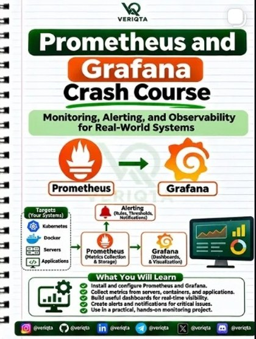</a> Prometheus and Grafana Crash Course <strong>PDF not available</strong></td>
<td align="center" valign="top" width="33%"><a href="MISSING.md#item-002">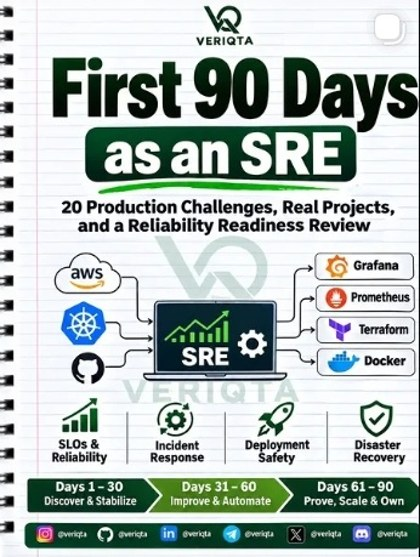</a> First 90 Days as an SRE <strong>PDF not available</strong></td>
<td align="center" valign="top" width="33%"><a href="MISSING.md#item-003">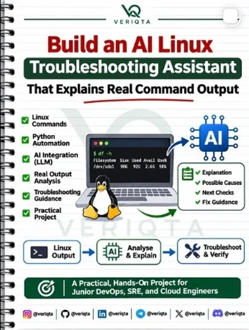</a> Build an AI Linux Troubleshooting Assistant That Explains Real Command Output <strong>PDF not available</strong></td>
</tr>
<tr>
<td align="center" valign="top" width="33%"><a href="../06.%20Kubernetes/20%20Kubernetes%20Production%20Projects.pdf">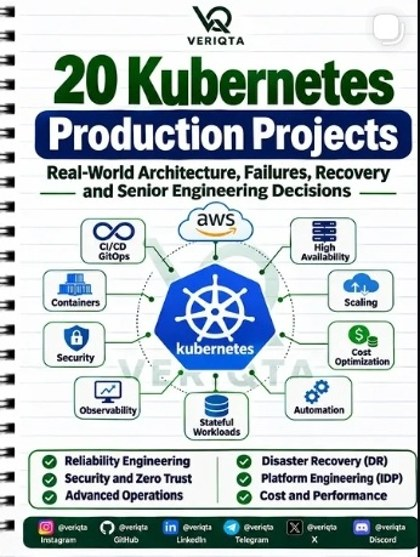</a> <a href="../06.%20Kubernetes/20%20Kubernetes%20Production%20Projects.pdf">20 Kubernetes Production Projects</a></td>
<td align="center" valign="top" width="33%"><a href="MISSING.md#item-005">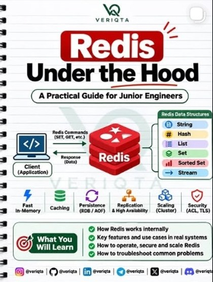</a> Redis Under the Hood <strong>PDF not available</strong></td>
<td align="center" valign="top" width="33%"><a href="../00.%20Linux/50%20Linux%20Interview%20Scenarios.pdf">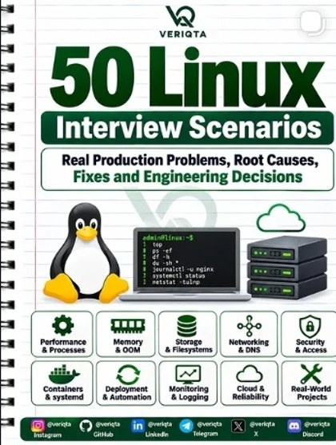</a> <a href="../00.%20Linux/50%20Linux%20Interview%20Scenarios.pdf">50 Linux Interview Scenarios</a></td>
</tr>
<tr>
<td align="center" valign="top" width="33%"><a href="../19.%20Cloud%20Security/Cloud%20Security%20Lab%2020%20Real%20Misconfigurations%20to%20Find%20and%20Fix.pdf">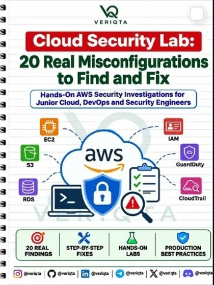</a> <a href="../19.%20Cloud%20Security/Cloud%20Security%20Lab%2020%20Real%20Misconfigurations%20to%20Find%20and%20Fix.pdf">Cloud Security Lab 20 Real Misconfigurations to Find and Fix</a></td>
<td align="center" valign="top" width="33%"><a href="../01.%20Programming%20%26%20Development/Python%20for%20DevOps%20Build%2010%20Command-Line%20Tools%20That%20Solve%20Real%20Problems.pdf">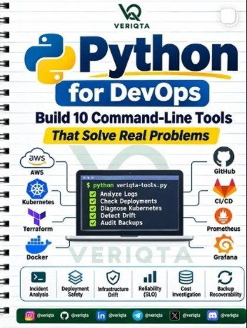</a> <a href="../01.%20Programming%20%26%20Development/Python%20for%20DevOps%20Build%2010%20Command-Line%20Tools%20That%20Solve%20Real%20Problems.pdf">Python for DevOps Build 10 Command-Line Tools That Solve Real Problems</a></td>
<td align="center" valign="top" width="33%"><a href="../15.%20Incident%20Response/50%20Production%20Incidents%20Every%20DevOps%20Engineer%20Should%20Know.pdf">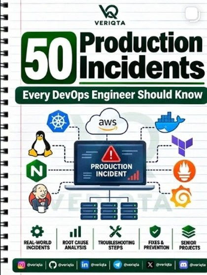</a> <a href="../15.%20Incident%20Response/50%20Production%20Incidents%20Every%20DevOps%20Engineer%20Should%20Know.pdf">50 Production Incidents Every DevOps Engineer Should Know</a></td>
</tr>
<tr>
<td align="center" valign="top" width="33%"><a href="../06.%20Kubernetes/The%20Kubernetes%20Handbook.pdf">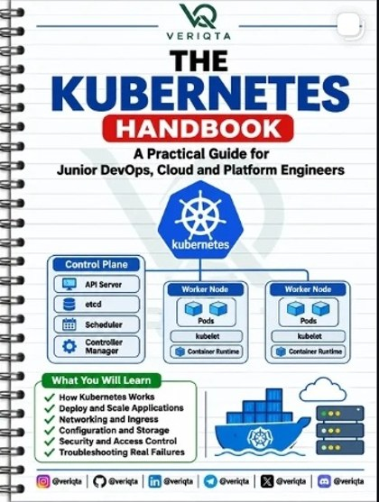</a> <a href="../06.%20Kubernetes/The%20Kubernetes%20Handbook.pdf">The Kubernetes Handbook</a></td>
<td align="center" valign="top" width="33%"><a href="MISSING.md#item-011">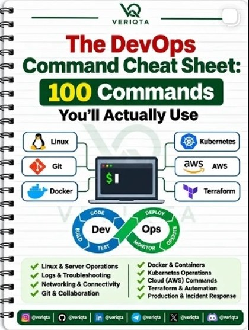</a> The DevOps Command Cheat Sheet: 100 Commands You’ll Actually Use <strong>PDF not available</strong></td>
<td align="center" valign="top" width="33%"><a href="../02.%20Networking/How%20to%20Read%20Network%20Traffic%20Like%20a%20Detective.pdf">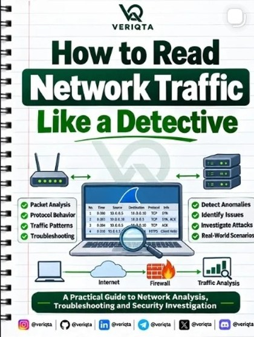</a> <a href="../02.%20Networking/How%20to%20Read%20Network%20Traffic%20Like%20a%20Detective.pdf">How to Read Network Traffic Like a Detective</a></td>
</tr>
<tr>
<td align="center" valign="top" width="33%"><a href="../28.%20Hands-On%20Projects/10%20Real-World%20DevOps%20Projects%20You%20Can%20Build%20and%20Add%20to%20GitHub.pdf">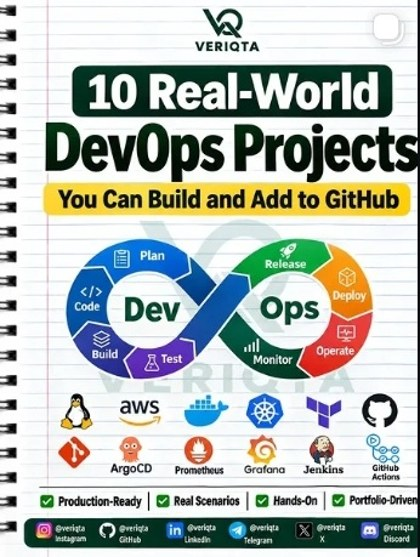</a> <a href="../28.%20Hands-On%20Projects/10%20Real-World%20DevOps%20Projects%20You%20Can%20Build%20and%20Add%20to%20GitHub.pdf">10 Real-World DevOps Projects You Can Build and Add to GitHub</a></td>
<td align="center" valign="top" width="33%"><a href="../10.%20Azure%20%26%20Google%20Cloud/Azure%20Cloud%20for%20Beginners%20Your%20First%2020%20Hands-On%20Labs%2C.pdf">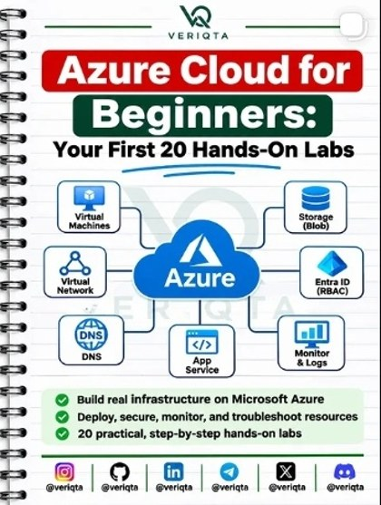</a> <a href="../10.%20Azure%20%26%20Google%20Cloud/Azure%20Cloud%20for%20Beginners%20Your%20First%2020%20Hands-On%20Labs%2C.pdf">Azure Cloud for Beginners Your First 20 Hands-On Labs,</a></td>
<td align="center" valign="top" width="33%"><a href="../07.%20CI-CD%20%26%20GitOps/GITHUB%20ACTION%20FOR%20AWS.pdf">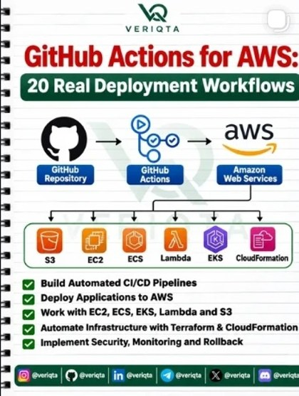</a> <a href="../07.%20CI-CD%20%26%20GitOps/GITHUB%20ACTION%20FOR%20AWS.pdf">GITHUB ACTION FOR AWS</a></td>
</tr>
<tr>
<td align="center" valign="top" width="33%"><a href="../00.%20Linux/Linux%20Black%20Book.pdf">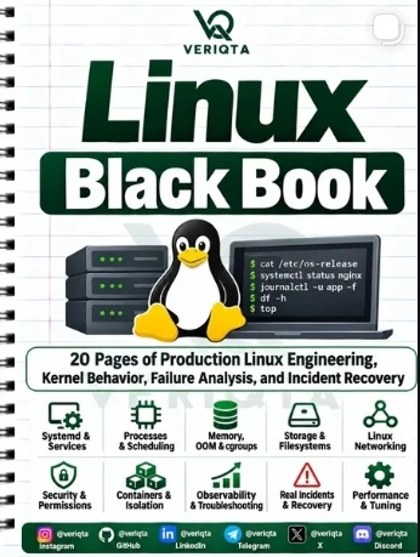</a> <a href="../00.%20Linux/Linux%20Black%20Book.pdf">Linux Black Book</a></td>
<td align="center" valign="top" width="33%"><a href="../04.%20DevOps/DevOps%20Toolchain%20Atlas.pdf">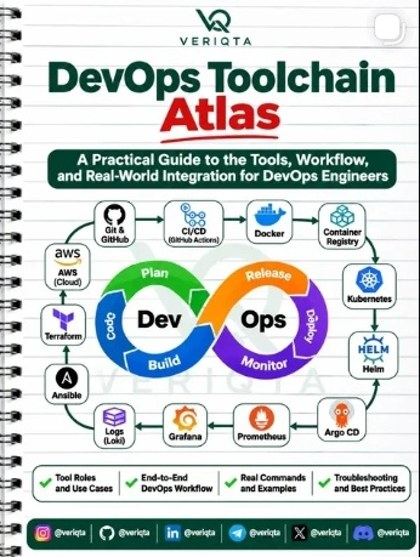</a> <a href="../04.%20DevOps/DevOps%20Toolchain%20Atlas.pdf">DevOps Toolchain Atlas</a></td>
<td align="center" valign="top" width="33%"><a href="../09.%20AWS/50%20AWS%20Interview%20Scenarios.pdf">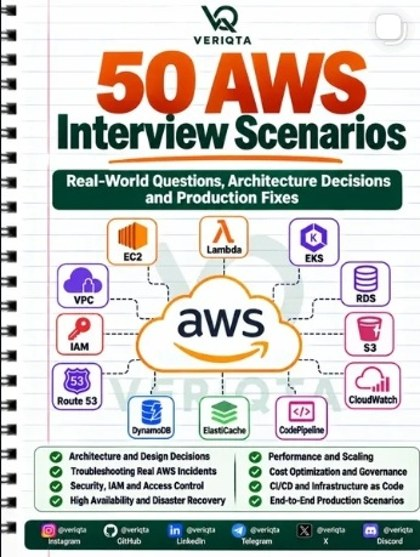</a> <a href="../09.%20AWS/50%20AWS%20Interview%20Scenarios.pdf">50 AWS Interview Scenarios</a></td>
</tr>
<tr>
<td align="center" valign="top" width="33%"><a href="../06.%20Kubernetes/The%20Kubernetes%20Troubleshooting%20Handbook%2050%20Errors%2C%20Causes%2C%20and%20Fixes.pdf">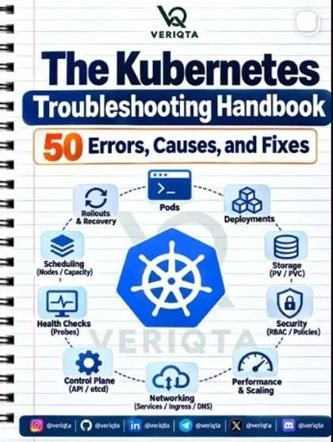</a> <a href="../06.%20Kubernetes/The%20Kubernetes%20Troubleshooting%20Handbook%2050%20Errors%2C%20Causes%2C%20and%20Fixes.pdf">The Kubernetes Troubleshooting Handbook 50 Errors, Causes, and Fixes</a></td>
<td align="center" valign="top" width="33%"><a href="../01.%20Programming%20%26%20Development/Golang%20for%20Beginners%20Your%20First%2010%20Scripts.pdf">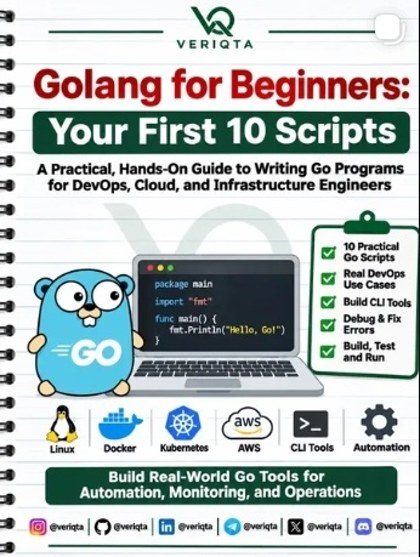</a> <a href="../01.%20Programming%20%26%20Development/Golang%20for%20Beginners%20Your%20First%2010%20Scripts.pdf">Golang for Beginners Your First 10 Scripts</a></td>
<td align="center" valign="top" width="33%"><a href="../27.%20Career%2C%20Interviews%20%26%20Certifications/Senior%20DevOps%20Interviews%20in%20the%20AI%20Era%2040%20Real%20Architecture%2C%20Security%2C%20Automation%2C%20and%20Production%20Scenarios.pdf">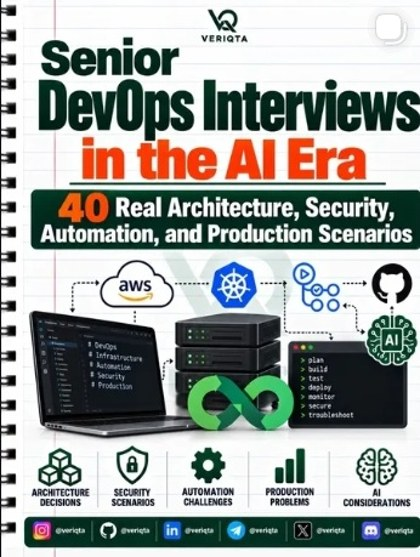</a> <a href="../27.%20Career%2C%20Interviews%20%26%20Certifications/Senior%20DevOps%20Interviews%20in%20the%20AI%20Era%2040%20Real%20Architecture%2C%20Security%2C%20Automation%2C%20and%20Production%20Scenarios.pdf">Senior DevOps Interviews in the AI Era 40 Real Architecture, Security, Automation, and Production Scenarios</a></td>
</tr>
<tr>
<td align="center" valign="top" width="33%"><a href="../27.%20Career%2C%20Interviews%20%26%20Certifications/DEVOPS%20ROADMAP%20FOR%20MID-LEVEL%20TO%20SENIOR.pdf">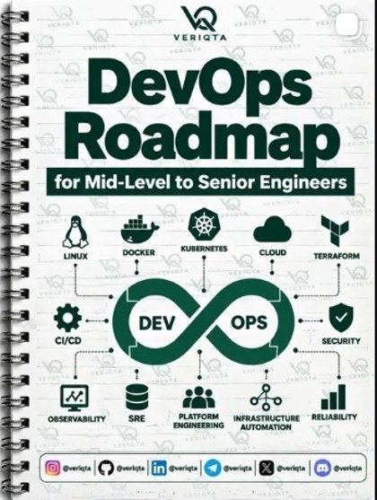</a> <a href="../27.%20Career%2C%20Interviews%20%26%20Certifications/DEVOPS%20ROADMAP%20FOR%20MID-LEVEL%20TO%20SENIOR.pdf">DEVOPS ROADMAP FOR MID-LEVEL TO SENIOR</a></td>
<td align="center" valign="top" width="33%"><a href="MISSING.md#item-023">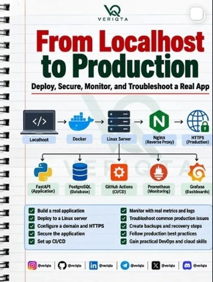</a> From Localhost to Production <strong>PDF not available</strong></td>
<td align="center" valign="top" width="33%"><a href="../07.%20CI-CD%20%26%20GitOps/The%20Advanced%20Jenkins%20Handbook%2030%20Production%20Pipelines%2C%20Security%20Patterns%2C%20and%20Troubleshooting%20Scenarios.pdf">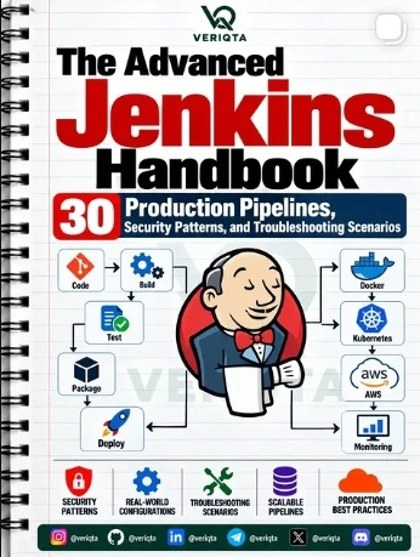</a> <a href="../07.%20CI-CD%20%26%20GitOps/The%20Advanced%20Jenkins%20Handbook%2030%20Production%20Pipelines%2C%20Security%20Patterns%2C%20and%20Troubleshooting%20Scenarios.pdf">The Advanced Jenkins Handbook 30 Production Pipelines, Security Patterns, and Troubleshooting Scenarios</a></td>
</tr>
<tr>
<td align="center" valign="top" width="33%"><a href="../19.%20Cloud%20Security/AWS%20Cloud%20Security%20for%20Beginners%20Secure%20Your%20First%20AWS%20Environment%20Step%20by%20Step.pdf">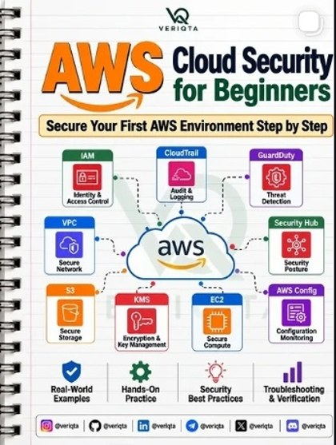</a> <a href="../19.%20Cloud%20Security/AWS%20Cloud%20Security%20for%20Beginners%20Secure%20Your%20First%20AWS%20Environment%20Step%20by%20Step.pdf">AWS Cloud Security for Beginners Secure Your First AWS Environment Step by Step</a></td>
<td align="center" valign="top" width="33%"><a href="../23.%20System%20Architecture%20%26%20Design/DevOps%20Architecture%20Diagrams%2030%20Real%20Systems%20Explained%20Step%20by%20Step.pdf">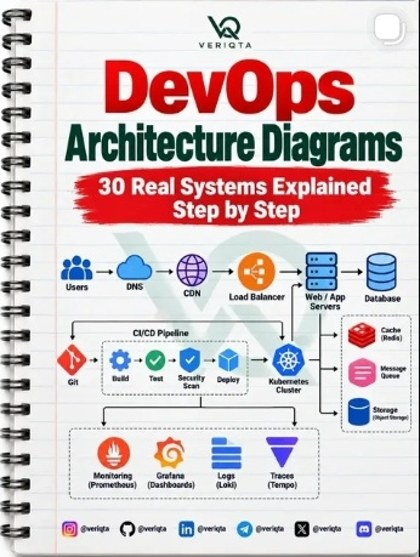</a> <a href="../23.%20System%20Architecture%20%26%20Design/DevOps%20Architecture%20Diagrams%2030%20Real%20Systems%20Explained%20Step%20by%20Step.pdf">DevOps Architecture Diagrams 30 Real Systems Explained Step by Step</a></td>
<td align="center" valign="top" width="33%"><a href="../15.%20Incident%20Response/FIRST%2030%20MINUTES%20OF%20%20A%20PRODUCTION%20INCIDENT.pdf">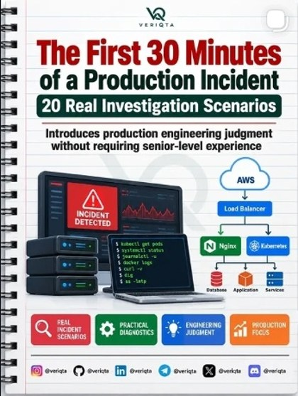</a> <a href="../15.%20Incident%20Response/FIRST%2030%20MINUTES%20OF%20%20A%20PRODUCTION%20INCIDENT.pdf">FIRST 30 MINUTES OF  A PRODUCTION INCIDENT</a></td>
</tr>
<tr>
<td align="center" valign="top" width="33%"><a href="../09.%20AWS/AWS%20API%20Gateway%20for%20Beginners%20Build%2C%20Secure%2C%20and%20Troubleshoot%20Your%20First%2010%20APIs.pdf">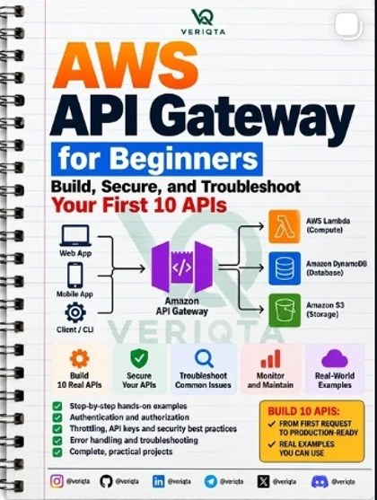</a> <a href="../09.%20AWS/AWS%20API%20Gateway%20for%20Beginners%20Build%2C%20Secure%2C%20and%20Troubleshoot%20Your%20First%2010%20APIs.pdf">AWS API Gateway for Beginners Build, Secure, and Troubleshoot Your First 10 APIs</a></td>
<td align="center" valign="top" width="33%"><a href="../08.%20Infrastructure%20as%20Code/10%20Terraform%20Projects%20for%20Your%20Portfolio.pdf">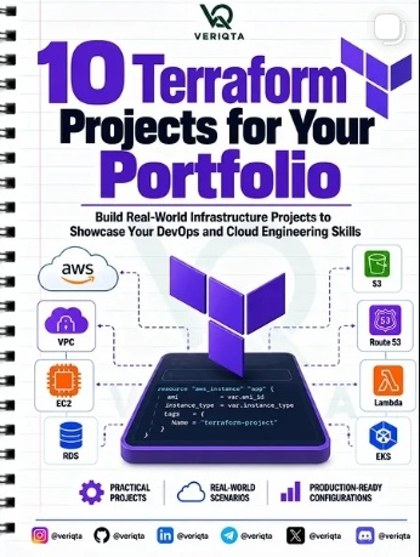</a> <a href="../08.%20Infrastructure%20as%20Code/10%20Terraform%20Projects%20for%20Your%20Portfolio.pdf">10 Terraform Projects for Your Portfolio</a></td>
<td align="center" valign="top" width="33%"><a href="../02.%20Networking/Networking%20Lab%20Manual%20for%20DevOps.pdf">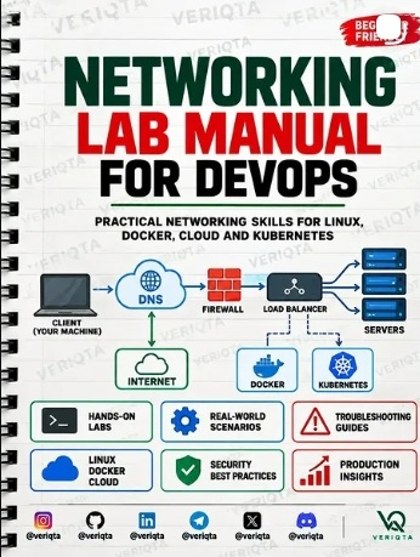</a> <a href="../02.%20Networking/Networking%20Lab%20Manual%20for%20DevOps.pdf">Networking Lab Manual for DevOps</a></td>
</tr>
<tr>
<td align="center" valign="top" width="33%"><a href="../23.%20System%20Architecture%20%26%20Design/SYSTEM%20DESIGN%20FOR%20BEGINNERS.pdf">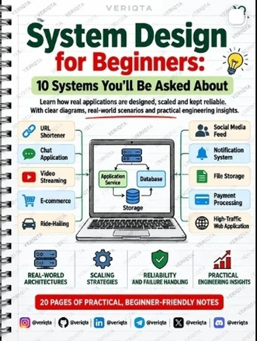</a> <a href="../23.%20System%20Architecture%20%26%20Design/SYSTEM%20DESIGN%20FOR%20BEGINNERS.pdf">SYSTEM DESIGN FOR BEGINNERS</a></td>
<td align="center" valign="top" width="33%"><a href="../02.%20Networking/Nginx%20for%20DevOps%20Engineers%2030%20Real%20Configurations%20and%20Fixes.pdf">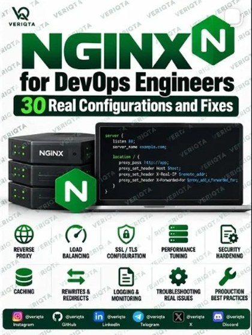</a> <a href="../02.%20Networking/Nginx%20for%20DevOps%20Engineers%2030%20Real%20Configurations%20and%20Fixes.pdf">Nginx for DevOps Engineers 30 Real Configurations and Fixes</a></td>
<td align="center" valign="top" width="33%"><a href="../02.%20Networking/HTTP%20ERROR%20CODE%20HANDBOOK.pdf">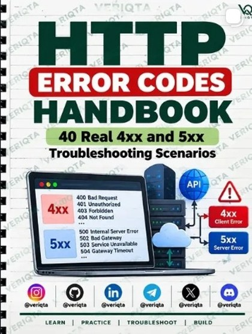</a> <a href="../02.%20Networking/HTTP%20ERROR%20CODE%20HANDBOOK.pdf">HTTP ERROR CODE HANDBOOK</a></td>
</tr>
<tr>
<td align="center" valign="top" width="33%"><a href="../00.%20Linux/Linux%20Troubleshooting%20Handbook%20100%20Commands%20for%20Real%20Production%20Failures.pdf">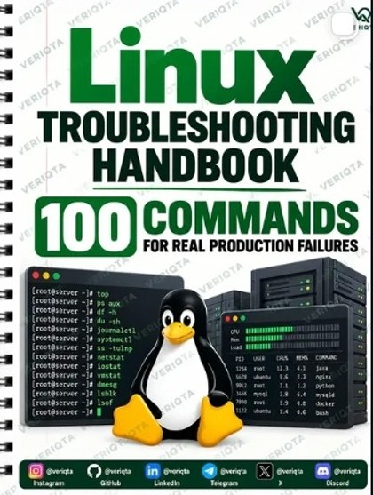</a> <a href="../00.%20Linux/Linux%20Troubleshooting%20Handbook%20100%20Commands%20for%20Real%20Production%20Failures.pdf">Linux Troubleshooting Handbook 100 Commands for Real Production Failures</a></td>
<td align="center" valign="top" width="33%"><a href="../21.%20AI%20for%20DevOps/AI%20for%20DevOps%20Engineers%20The%20Practical%20Handbook.pdf">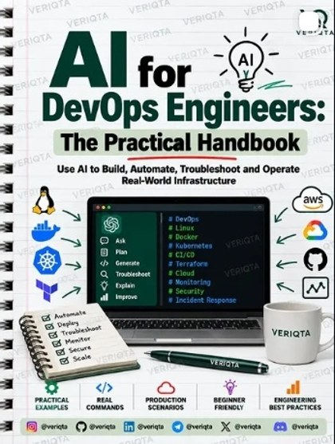</a> <a href="../21.%20AI%20for%20DevOps/AI%20for%20DevOps%20Engineers%20The%20Practical%20Handbook.pdf">AI for DevOps Engineers The Practical Handbook</a></td>
<td align="center" valign="top" width="33%"><a href="../29.%20Engineering%20Portfolio%20%26%20Home%20Labs/The%20DevOps%20Side%20Project%20Playbook%2010%20Ideas%20That%20Get%20You%20Hired.pdf">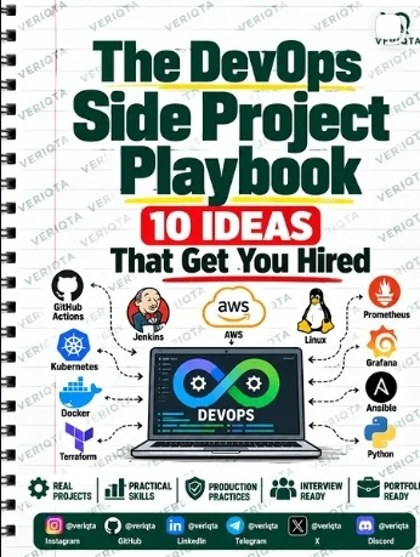</a> <a href="../29.%20Engineering%20Portfolio%20%26%20Home%20Labs/The%20DevOps%20Side%20Project%20Playbook%2010%20Ideas%20That%20Get%20You%20Hired.pdf">The DevOps Side Project Playbook 10 Ideas That Get You Hired</a></td>
</tr>
<tr>
<td align="center" valign="top" width="33%"><a href="../11.%20Databases/50%20Redis%20Interview%20Scenarios%20Questions%2C%20Answers%2C%20and%20Production%20Troubleshooting.pdf">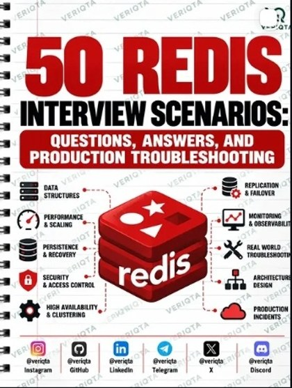</a> <a href="../11.%20Databases/50%20Redis%20Interview%20Scenarios%20Questions%2C%20Answers%2C%20and%20Production%20Troubleshooting.pdf">50 Redis Interview Scenarios Questions, Answers, and Production Troubleshooting</a></td>
<td align="center" valign="top" width="33%"><a href="../09.%20AWS/Build%20a%20Three-Tier%20App%20on%20AWS%20The%20Project%20That%20Gets%20You%20Hired.pdf">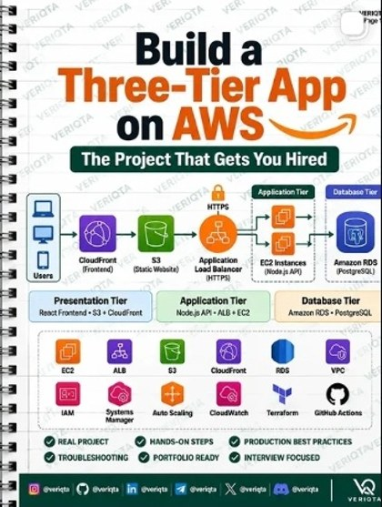</a> <a href="../09.%20AWS/Build%20a%20Three-Tier%20App%20on%20AWS%20The%20Project%20That%20Gets%20You%20Hired.pdf">Build a Three-Tier App on AWS The Project That Gets You Hired</a></td>
<td align="center" valign="top" width="33%"><a href="MISSING.md#item-039">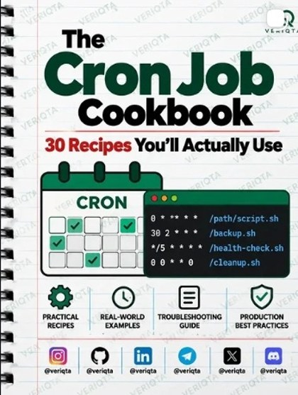</a> The Cron Job Cookbook: 30 Recipes You’ll Actually Use <strong>PDF not available</strong></td>
</tr>
<tr>
<td align="center" valign="top" width="33%"><a href="../16.%20Troubleshooting/Reading%20Logs%20Like%20a%20Detective%20A%20Beginner%27s%20Playbook.pdf">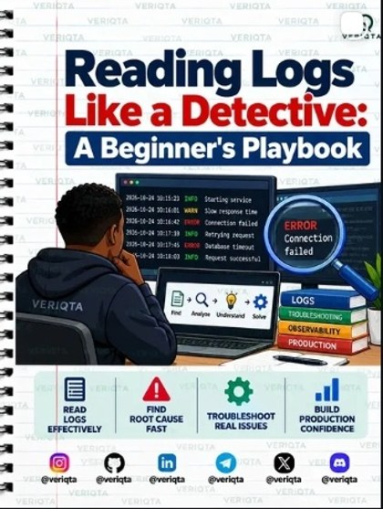</a> <a href="../16.%20Troubleshooting/Reading%20Logs%20Like%20a%20Detective%20A%20Beginner%27s%20Playbook.pdf">Reading Logs Like a Detective A Beginner&#x27;s Playbook</a></td>
<td align="center" valign="top" width="33%"><a href="../21.%20AI%20for%20DevOps/Your%20First%20AI%20Agent%20on%20AWS%20Build%20One%20Step%20by%20Step.pdf">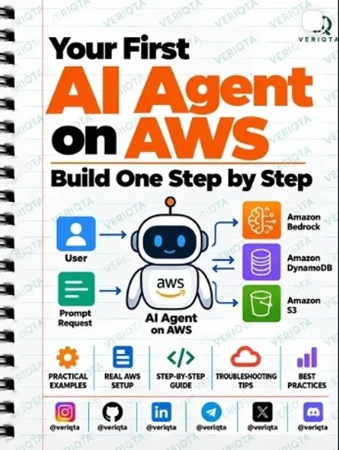</a> <a href="../21.%20AI%20for%20DevOps/Your%20First%20AI%20Agent%20on%20AWS%20Build%20One%20Step%20by%20Step.pdf">Your First AI Agent on AWS Build One Step by Step</a></td>
<td align="center" valign="top" width="33%"><a href="../06.%20Kubernetes/ArgoCD%20for%20Beginners%20Your%20First%20GitOps%20Deployment.pdf">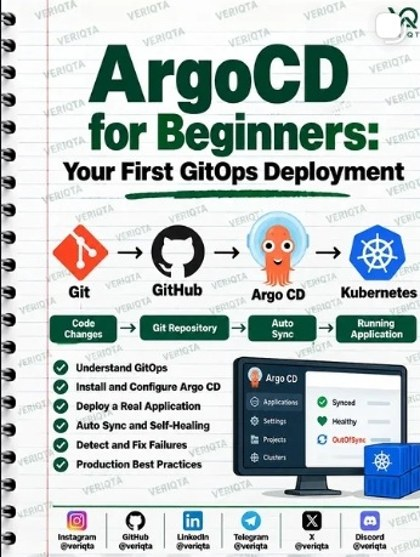</a> <a href="../06.%20Kubernetes/ArgoCD%20for%20Beginners%20Your%20First%20GitOps%20Deployment.pdf">ArgoCD for Beginners Your First GitOps Deployment</a></td>
</tr>
<tr>
<td align="center" valign="top" width="33%"><a href="MISSING.md#item-043">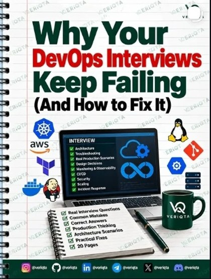</a> Why Your DevOps Interviews Keep Failing (And How to Fix It) <strong>PDF not available</strong></td>
<td align="center" valign="top" width="33%"><a href="../16.%20Troubleshooting/The%20Beginner%27s%20Troubleshooting%20Playbook%20How%20to%20Diagnose%20Real%20DevOps%20Failures.pdf">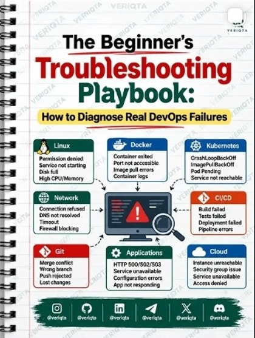</a> <a href="../16.%20Troubleshooting/The%20Beginner%27s%20Troubleshooting%20Playbook%20How%20to%20Diagnose%20Real%20DevOps%20Failures.pdf">The Beginner&#x27;s Troubleshooting Playbook How to Diagnose Real DevOps Failures</a></td>
<td align="center" valign="top" width="33%"><a href="../27.%20Career%2C%20Interviews%20%26%20Certifications/What%20Senior%20DevOps%20Interviews%20Actually%20Test%2040%20Real%20Scenarios.pdf">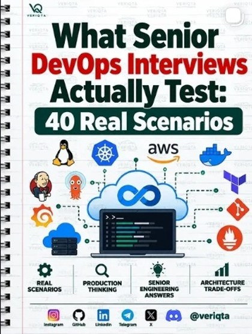</a> <a href="../27.%20Career%2C%20Interviews%20%26%20Certifications/What%20Senior%20DevOps%20Interviews%20Actually%20Test%2040%20Real%20Scenarios.pdf">What Senior DevOps Interviews Actually Test 40 Real Scenarios</a></td>
</tr>
<tr>
<td align="center" valign="top" width="33%"><a href="../27.%20Career%2C%20Interviews%20%26%20Certifications/Your%20DevOps%20Resume%20The%202026%20Interview%20Playbook.pdf">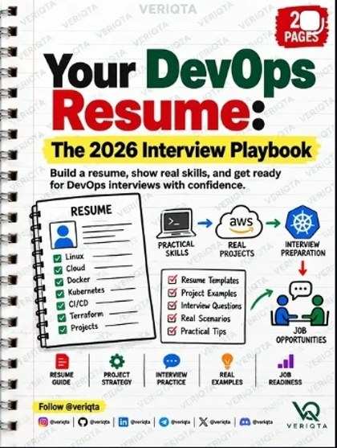</a> <a href="../27.%20Career%2C%20Interviews%20%26%20Certifications/Your%20DevOps%20Resume%20The%202026%20Interview%20Playbook.pdf">Your DevOps Resume The 2026 Interview Playbook</a></td>
<td align="center" valign="top" width="33%"><a href="../00.%20Linux/Linux%20File%20Permissions%20The%20Beginner%27s%20Visual%20Guide.pdf">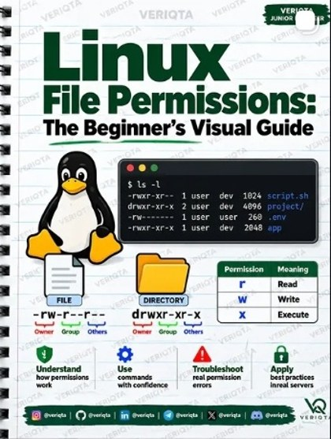</a> <a href="../00.%20Linux/Linux%20File%20Permissions%20The%20Beginner%27s%20Visual%20Guide.pdf">Linux File Permissions The Beginner&#x27;s Visual Guide</a></td>
<td align="center" valign="top" width="33%"><a href="../01.%20Programming%20%26%20Development/API%20Handbook%20for%20DevOps%20Beginners.pdf">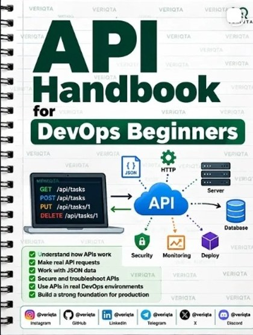</a> <a href="../01.%20Programming%20%26%20Development/API%20Handbook%20for%20DevOps%20Beginners.pdf">API Handbook for DevOps Beginners</a></td>
</tr>
<tr>
<td align="center" valign="top" width="33%"><a href="../01.%20Programming%20%26%20Development/Python%20for%20DevOps%20Your%20First%2010%20Scripts.pdf">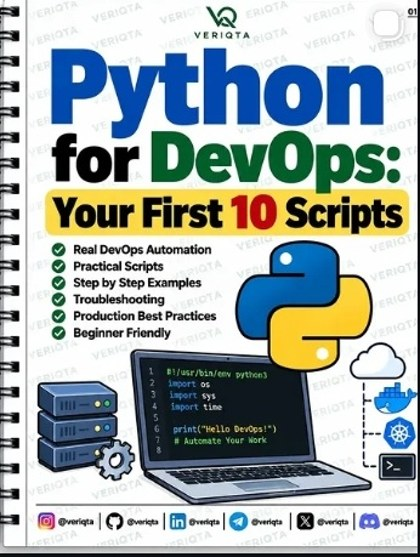</a> <a href="../01.%20Programming%20%26%20Development/Python%20for%20DevOps%20Your%20First%2010%20Scripts.pdf">Python for DevOps Your First 10 Scripts</a></td>
<td align="center" valign="top" width="33%"><a href="../29.%20Engineering%20Portfolio%20%26%20Home%20Labs/How%20to%20Set%20Up%20Your%20DevOps%20Home%20Lab%20on%20a%20Budget.pdf">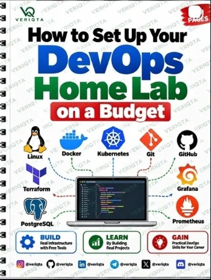</a> <a href="../29.%20Engineering%20Portfolio%20%26%20Home%20Labs/How%20to%20Set%20Up%20Your%20DevOps%20Home%20Lab%20on%20a%20Budget.pdf">How to Set Up Your DevOps Home Lab on a Budget</a></td>
<td align="center" valign="top" width="33%"> <a href="../09.%20AWS/10%20AWS%20Hands-On%20Projects%20for%20Beginners.pdf">10 AWS Hands-On Projects for Beginners</a></td>
</tr>
<tr>
<td align="center" valign="top" width="33%"> <a href="../08.%20Infrastructure%20as%20Code/Ansible%20for%20Beginners%20Your%20First%20Playbook.pdf">Ansible for Beginners Your First Playbook</a></td>
<td align="center" valign="top" width="33%"> <a href="../07.%20CI-CD%20%26%20GitOps/GitHub%20Actions%20Your%20First%20Pipeline%20Step%20by%20Step.pdf">GitHub Actions Your First Pipeline Step by Step</a></td>
<td align="center" valign="top" width="33%"> <a href="../07.%20CI-CD%20%26%20GitOps/Zero-Downtime%20Deployments%20Explained%20Rolling%20Updates%2C%20Blue-Green%2C%20and%20Canary%20Deployments.pdf">Zero-Downtime Deployments Explained Rolling Updates, Blue-Green, and Canary Deployments</a></td>
</tr>
<tr>
<td align="center" valign="top" width="33%"> <a href="../13.%20Monitoring%20%26%20Observability/Prometheus%20and%20Grafana%20for%20Beginners%20Your%20First%20Dashboard.pdf">Prometheus and Grafana for Beginners Your First Dashboard</a></td>
<td align="center" valign="top" width="33%"> <a href="../05.%20Docker%20%26%20Containers/Docker%20Compose%20From%20Zero%20to%20Multi-Container.pdf">Docker Compose From Zero to Multi-Container</a></td>
<td align="center" valign="top" width="33%"> <a href="../02.%20Networking/The%20Networking%20Concepts%20DevOps%20Interviews%20Actually%20Test.pdf">The Networking Concepts DevOps Interviews Actually Test</a></td>
</tr>
<tr>
<td align="center" valign="top" width="33%"> <a href="../06.%20Kubernetes/Kubernetes%20for%20Beginners%20Your%20First%20Pod%2C%20Service%2C%20and%20Deployment.pdf">Kubernetes for Beginners Your First Pod, Service, and Deployment</a></td>
<td align="center" valign="top" width="33%"> <a href="../07.%20CI-CD%20%26%20GitOps/15%20CICD%20Mistakes%20That%20Break%20Production%20%28and%20How%20to%20Avoid%20Them%29.pdf">15 CICD Mistakes That Break Production (and How to Avoid Them)</a></td>
<td align="center" valign="top" width="33%"> <a href="../27.%20Career%2C%20Interviews%20%26%20Certifications/Your%20First%20Month%20as%20a%20DevOps%20Engineer%20A%20Week-by-Week%20Plan.pdf">Your First Month as a DevOps Engineer A Week-by-Week Plan</a></td>
</tr>
<tr>
<td align="center" valign="top" width="33%"> <a href="../03.%20Shell%20Scripting/Bash%20Scripting%20for%20Beginners%20Your%20First%2010%20Scripts.pdf">Bash Scripting for Beginners Your First 10 Scripts</a></td>
<td align="center" valign="top" width="33%"> <a href="../08.%20Infrastructure%20as%20Code/Terraform%20in%20Plain%20English.pdf">Terraform in Plain English</a></td>
<td align="center" valign="top" width="33%"> <a href="../09.%20AWS/From%20Zero%20to%20Deployed%20Your%20First%20App%20on%20AWS.pdf">From Zero to Deployed Your First App on AWS</a></td>
</tr>
<tr>
<td align="center" valign="top" width="33%"> <a href="../04.%20DevOps/The%20DevOps%20Glossary%20100%20Terms%20Explained%20Simply.pdf">The DevOps Glossary 100 Terms Explained Simply</a></td>
<td align="center" valign="top" width="33%"> <a href="../05.%20Docker%20%26%20Containers/ANATOMY%20OF%20A%20Dockerfile.pdf">ANATOMY OF A Dockerfile</a></td>
<td align="center" valign="top" width="33%"> <a href="../04.%20DevOps/100%20DEVOPS%20COMMANDS%20REFERENCE.pdf">100 DEVOPS COMMANDS REFERENCE</a></td>
</tr>
<tr>
<td align="center" valign="top" width="33%"> <a href="../29.%20Engineering%20Portfolio%20%26%20Home%20Labs/10%20GitHub%20repo%20that%20will%20get%20you%20hired%20in%20DevOps.pdf">10 GitHub repo that will get you hired in DevOps</a></td>
<td align="center" valign="top" width="33%"> <a href="../06.%20Kubernetes/KUBECTL%20COMMANDS%20YOU%27LL%20ACTUALLY%20USE.pdf">KUBECTL COMMANDS YOU&#x27;LL ACTUALLY USE</a></td>
<td align="center" valign="top" width="33%"> <a href="../27.%20Career%2C%20Interviews%20%26%20Certifications/DevOps%20Roadmap%20from%20ZERO%20to%20First%20Job.pdf">DevOps Roadmap from ZERO to First Job</a></td>
</tr>
<tr>
<td align="center" valign="top" width="33%"> <a href="../27.%20Career%2C%20Interviews%20%26%20Certifications/50%20Most%20Repeated%20DevOps%20Interview%20Questions%20%282026%20Edition%29.pdf">50 Most Repeated DevOps Interview Questions (2026 Edition)</a></td>
<td align="center" valign="top" width="33%"> <a href="../00.%20Linux/LINUX%20ESSENTIALS%20FOR%20ENGINEERS.pdf">LINUX ESSENTIALS FOR ENGINEERS</a></td>
<td align="center" valign="top" width="33%"> <a href="../07.%20CI-CD%20%26%20GitOps/CICD%20PIPELINE.pdf">CICD PIPELINE</a></td>
</tr>
<tr>
<td align="center" valign="top" width="33%"> <a href="../09.%20AWS/AWS%20INCIDENT%20RESPONSE%20HANDBOOK.pdf">AWS INCIDENT RESPONSE HANDBOOK</a></td>
<td align="center" valign="top" width="33%"> <a href="../27.%20Career%2C%20Interviews%20%26%20Certifications/DEVOPS%20%20ARCHITECTURE%20INTERVIEW%20HANDBOOK.pdf">DEVOPS  ARCHITECTURE INTERVIEW HANDBOOK</a></td>
<td align="center" valign="top" width="33%"> <a href="../02.%20Networking/SENIOR%20NETWORKING%20BIBLE%20FOR.pdf">SENIOR NETWORKING BIBLE FOR</a></td>
</tr>
<tr>
<td align="center" valign="top" width="33%"> <a href="../05.%20Docker%20%26%20Containers/DOCKER%20CHEAT%20SHEETS.pdf">DOCKER CHEAT SHEETS</a></td>
<td align="center" valign="top" width="33%"> <a href="../06.%20Kubernetes/KUBERNETES%20TOOLKIT.pdf">KUBERNETES TOOLKIT</a></td>
<td align="center" valign="top" width="33%"> The Enterprise Incident Response Black Book <strong>PDF not available</strong></td>
</tr>
<tr>
<td align="center" valign="top" width="33%"> <a href="../01.%20Programming%20%26%20Development/PYTHON%20AUTOMATION%20WITH%20AI.pdf">PYTHON AUTOMATION WITH AI</a></td>
<td align="center" valign="top" width="33%"> <a href="../02.%20Networking/NETWORK%20ENGINEERS%20COMPANION.pdf">NETWORK ENGINEERS COMPANION</a></td>
<td align="center" valign="top" width="33%"> <a href="../01.%20Programming%20%26%20Development/Master%20Git%20Commands%20with%20This%20Handy%20Cheat%20Sheet.pdf">Master Git Commands with This Handy Cheat Sheet</a></td>
</tr>
<tr>
<td align="center" valign="top" width="33%"> <a href="../20.%20Platform%20Engineering/PLATFORM%20ENGINEERING%20BOOTCAMP.pdf">PLATFORM ENGINEERING BOOTCAMP</a></td>
<td align="center" valign="top" width="33%"> <a href="../28.%20Hands-On%20Projects/DEVOPS%20GITHUB%20PORTFOLIO%20PROJECTS%20HANDBOOK.pdf">DEVOPS GITHUB PORTFOLIO PROJECTS HANDBOOK</a></td>
<td align="center" valign="top" width="33%"> <a href="../06.%20Kubernetes/20%20KUBERNETES%20GRADE%20PROJECTS%20%20FOR%20OPERATOR%20AND%20CONTROLLER.pdf">20 KUBERNETES GRADE PROJECTS  FOR OPERATOR AND CONTROLLER</a></td>
</tr>
<tr>
<td align="center" valign="top" width="33%"> <a href="../05.%20Docker%20%26%20Containers/PODMAN%20ESSENTIALS.pdf">PODMAN ESSENTIALS</a></td>
<td align="center" valign="top" width="33%"> <a href="../26.%20Staff%20%26%20Principal%20Engineering/THE%20STAFF%20DEVOPS%20ENGINEER%20HANDBOOK.pdf">THE STAFF DEVOPS ENGINEER HANDBOOK</a></td>
<td align="center" valign="top" width="33%"> <a href="../13.%20Monitoring%20%26%20Observability/NEW%20RELIC%20FOR%20JUNIOR%20DEVOPS%20ENGINEER.pdf">NEW RELIC FOR JUNIOR DEVOPS ENGINEER</a></td>
</tr>
<tr>
<td align="center" valign="top" width="33%"> <a href="../07.%20CI-CD%20%26%20GitOps/CICD%20SECURITY%20PLAYBOOK.pdf">CICD SECURITY PLAYBOOK</a></td>
<td align="center" valign="top" width="33%"> <a href="../12.%20Infrastructure%20Engineering/INFRASTRUCTURE%20ENGINEERS%20COMPANION.pdf">INFRASTRUCTURE ENGINEERS COMPANION</a></td>
<td align="center" valign="top" width="33%"> <a href="../17.%20Production%20Engineering/FIRST%20ON-CALL%20SURVIVAL%20GUIDE.pdf">FIRST ON-CALL SURVIVAL GUIDE</a></td>
</tr>
<tr>
<td align="center" valign="top" width="33%"> <a href="../09.%20AWS/20%20AWS%20Production%20Architecture%20Projects.pdf">20 AWS Production Architecture Projects</a></td>
<td align="center" valign="top" width="33%"> <a href="../14.%20SRE%20%26%20Reliability%20Engineering/SRE%20BIBLE.pdf">SRE BIBLE</a></td>
<td align="center" valign="top" width="33%"> <a href="../00.%20Linux/ANATOMY%20OF%20A%20LINUX%20SYSTEM.pdf">ANATOMY OF A LINUX SYSTEM</a></td>
</tr>
<tr>
<td align="center" valign="top" width="33%"> <a href="../07.%20CI-CD%20%26%20GitOps/Jenkins%20Administrator%20Guild.pdf">Jenkins Administrator Guild</a></td>
<td align="center" valign="top" width="33%"> <a href="../06.%20Kubernetes/ARGO%20CD%20ZERO%20TO%20PRODUCTION.pdf">ARGO CD ZERO TO PRODUCTION</a></td>
<td align="center" valign="top" width="33%"> <a href="../04.%20DevOps/DEVOPS%20CODE%20REVIEW%20HANDBOOK.pdf">DEVOPS CODE REVIEW HANDBOOK</a></td>
</tr>
<tr>
<td align="center" valign="top" width="33%"> <a href="../01.%20Programming%20%26%20Development/YAML%20for%20beginners.pdf">YAML for beginners</a></td>
<td align="center" valign="top" width="33%"> <a href="../12.%20Infrastructure%20Engineering/Kafka%20Production%20Handbook.pdf">Kafka Production Handbook</a></td>
<td align="center" valign="top" width="33%"> <a href="../00.%20Linux/LINUX%20ADMINISTRATOR%20COMMAND%20LINE%20TOOLKIT.pdf">LINUX ADMINISTRATOR COMMAND LINE TOOLKIT</a></td>
</tr>
<tr>
<td align="center" valign="top" width="33%"> <a href="../22.%20AI%20Infrastructure%20%26%20MLOps/GPU%20INFRASTRUCTURE%20101.pdf">GPU INFRASTRUCTURE 101</a></td>
<td align="center" valign="top" width="33%"> <a href="../06.%20Kubernetes/OPENSHIFT%20FOR%20COMPLETE%20BEGINNER%27S.pdf">OPENSHIFT FOR COMPLETE BEGINNER&#x27;S</a></td>
<td align="center" valign="top" width="33%"> <a href="../22.%20AI%20Infrastructure%20%26%20MLOps/MLOPs%20for%20devops%20and%20platform%20engineers.pdf">MLOPs for devops and platform engineers</a></td>
</tr>
<tr>
<td align="center" valign="top" width="33%"> <a href="../06.%20Kubernetes/Kubernetes%20under%20the%20hood.pdf">Kubernetes under the hood</a></td>
<td align="center" valign="top" width="33%"> <a href="../00.%20Linux/LINUX%20INTERNAL%20FOR%20DEVOPS%20ENGINEER.pdf">LINUX INTERNAL FOR DEVOPS ENGINEER</a></td>
<td align="center" valign="top" width="33%"> <a href="../24.%20Advanced%20Engineering%20Internals/eBPF%20for%20devops%20%26%20infrastructure%20engineer.pdf">eBPF for devops &amp; infrastructure engineer</a></td>
</tr>
<tr>
<td align="center" valign="top" width="33%"> <a href="../09.%20AWS/AWS%20INFRASTRUCTURE%20LAB%20MANUAL.pdf">AWS INFRASTRUCTURE LAB MANUAL</a></td>
<td align="center" valign="top" width="33%"> <a href="../22.%20AI%20Infrastructure%20%26%20MLOps/GPU%20INFRASTRUCTURE%20FOR%20PLATFORM%20ENGINEERS.pdf">GPU INFRASTRUCTURE FOR PLATFORM ENGINEERS</a></td>
<td align="center" valign="top" width="33%"> <a href="../08.%20Infrastructure%20as%20Code/TERRAFORM%20CRASH%20COURSE.pdf">TERRAFORM CRASH COURSE</a></td>
</tr>
<tr>
<td align="center" valign="top" width="33%"> <a href="../17.%20Production%20Engineering/THE%20PRODUCTION%20ENVIRONMENT%20TAKEOVER%20HANDBOOK.pdf">THE PRODUCTION ENVIRONMENT TAKEOVER HANDBOOK</a></td>
<td align="center" valign="top" width="33%"> <a href="../00.%20Linux/LINUX%20ADMINISTRATOR%20SURVIVAL%20GUIDE.pdf">LINUX ADMINISTRATOR SURVIVAL GUIDE</a></td>
<td align="center" valign="top" width="33%"> <a href="../16.%20Troubleshooting/DEVOPS%20TROUBLESHOOTING%20ENCYCLOPEDIA.pdf">DEVOPS TROUBLESHOOTING ENCYCLOPEDIA</a></td>
</tr>
<tr>
<td align="center" valign="top" width="33%"> <a href="../28.%20Hands-On%20Projects/20%20ADVANCED%20INFRASTRUCTURE%20PROJECTS.pdf">20 ADVANCED INFRASTRUCTURE PROJECTS</a></td>
<td align="center" valign="top" width="33%"> <a href="../22.%20AI%20Infrastructure%20%26%20MLOps/AI%20INFRASTRUCTURE%20ENGINEERING%20FUNDAMENTALS.pdf">AI INFRASTRUCTURE ENGINEERING FUNDAMENTALS</a></td>
<td align="center" valign="top" width="33%"> <a href="../02.%20Networking/NGINX%20CRASH%20COURSE.pdf">NGINX CRASH COURSE</a></td>
</tr>
<tr>
<td align="center" valign="top" width="33%"> <a href="../07.%20CI-CD%20%26%20GitOps/GITLAB%20ADMINISTRATOR%27S%20GUIDE.pdf">GITLAB ADMINISTRATOR&#x27;S GUIDE</a></td>
<td align="center" valign="top" width="33%"> <a href="../09.%20AWS/AWS%20BLACK%20BOOK.pdf">AWS BLACK BOOK</a></td>
<td align="center" valign="top" width="33%"> <a href="../08.%20Infrastructure%20as%20Code/ANSIBLE%20CRASH%20COURSE.pdf">ANSIBLE CRASH COURSE</a></td>
</tr>
<tr>
<td align="center" valign="top" width="33%"> <a href="../07.%20CI-CD%20%26%20GitOps/ANATOMY%20OF%20CICD%20PIPELINE.pdf">ANATOMY OF CICD PIPELINE</a></td>
<td align="center" valign="top" width="33%"> <a href="../27.%20Career%2C%20Interviews%20%26%20Certifications/SENIOR%20DEVOPS%20INTERVIEW%20HANDBOOK.pdf">SENIOR DEVOPS INTERVIEW HANDBOOK</a></td>
<td align="center" valign="top" width="33%"> <a href="../00.%20Linux/LINUX%20AUTOMATION%20COOKBOOK.pdf">LINUX AUTOMATION COOKBOOK</a></td>
</tr>
<tr>
<td align="center" valign="top" width="33%"> <a href="../10.%20Azure%20%26%20Google%20Cloud/AZURE%20DEVOPS%20POCKET%20GUIDE.pdf">AZURE DEVOPS POCKET GUIDE</a></td>
<td align="center" valign="top" width="33%"> <a href="../10.%20Azure%20%26%20Google%20Cloud/GCP%20FOR%20DEVOPS%20ENGINEER.pdf">GCP FOR DEVOPS ENGINEER</a></td>
<td align="center" valign="top" width="33%"> CI/CD Operations Manual <strong>PDF not available</strong></td>
</tr>
<tr>
<td align="center" valign="top" width="33%"> <a href="../01.%20Programming%20%26%20Development/PYTHON%20AUTOMATION%20POCKET%20GUIDE.pdf">PYTHON AUTOMATION POCKET GUIDE</a></td>
<td align="center" valign="top" width="33%"> <a href="../01.%20Programming%20%26%20Development/GO%20FOR%20DEVOPS%20ENGINEER.pdf">GO FOR DEVOPS ENGINEER</a></td>
<td align="center" valign="top" width="33%"> <a href="../08.%20Infrastructure%20as%20Code/TERRAFORM%20FOR%20SENIOR%20INFRASTRUCTURE%20ENGINEERS.pdf">TERRAFORM FOR SENIOR INFRASTRUCTURE ENGINEERS</a></td>
</tr>
<tr>
<td align="center" valign="top" width="33%"> <a href="../06.%20Kubernetes/KUBERNETES%20ADMINISTRATOR%27S%20SURVIVAL%20GUIDE.pdf">KUBERNETES ADMINISTRATOR&#x27;S SURVIVAL GUIDE</a></td>
<td align="center" valign="top" width="33%"> <a href="../02.%20Networking/NETWORK%20ENGINEERING%20GUIDEBOOK.pdf">NETWORK ENGINEERING GUIDEBOOK</a></td>
<td align="center" valign="top" width="33%"> DevOps Engineer’s Companion: Everyday DevOps Knowledge <strong>PDF not available</strong></td>
</tr>
<tr>
<td align="center" valign="top" width="33%"> <a href="../15.%20Incident%20Response/INCIDENT%20RESPONSE%20PLAYBOOK.pdf">INCIDENT RESPONSE PLAYBOOK</a></td>
<td align="center" valign="top" width="33%"> <a href="../00.%20Linux/LINUX%20ENGINEERING%20BIBLE.pdf">LINUX ENGINEERING BIBLE</a></td>
<td align="center" valign="top" width="33%"> <a href="../23.%20System%20Architecture%20%26%20Design/PRODUCTION%20ARCHITECTURE%20FOR%20DEVOPS%20ENGINEERS.pdf">PRODUCTION ARCHITECTURE FOR DEVOPS ENGINEERS</a></td>
</tr>
<tr>
<td align="center" valign="top" width="33%"> <a href="../04.%20DevOps/DEVOPS%20COMMAND%20REFERENCE.pdf">DEVOPS COMMAND REFERENCE</a></td>
<td align="center" valign="top" width="33%"> <a href="../08.%20Infrastructure%20as%20Code/ADVANCE%20TERRAFORM%20PRODUCTION.pdf">ADVANCE TERRAFORM PRODUCTION</a></td>
<td align="center" valign="top" width="33%"> <a href="../07.%20CI-CD%20%26%20GitOps/50%20CICD%20MISTAKES%20AND%20HOW%20TO%20FIX%20THEM.pdf">50 CICD MISTAKES AND HOW TO FIX THEM</a></td>
</tr>
<tr>
<td align="center" valign="top" width="33%"> <a href="../09.%20AWS/AWS%20POCKET%20GUIDE.pdf">AWS POCKET GUIDE</a></td>
<td align="center" valign="top" width="33%"> <a href="../00.%20Linux/LINUX%20POCKET%20GUIDE.pdf">LINUX POCKET GUIDE</a></td>
<td align="center" valign="top" width="33%"> <a href="../27.%20Career%2C%20Interviews%20%26%20Certifications/100%20REAL-WORLD%20DEVOPS%20INTERVIEW%20SCENARIOS.pdf">100 REAL-WORLD DEVOPS INTERVIEW SCENARIOS</a></td>
</tr>
<tr>
<td align="center" valign="top" width="33%"> <a href="../18.%20DevSecOps%20%26%20Identity/DEVSECOPS%20BOOTCAMP.pdf">DEVSECOPS BOOTCAMP</a></td>
<td align="center" valign="top" width="33%"> <a href="../04.%20DevOps/DEVOPS%20POCKEK%20GUIDE.pdf">DEVOPS POCKEK GUIDE</a></td>
<td align="center" valign="top" width="33%"> <a href="../02.%20Networking/NETWORKING%20FOR%20SENIOR%20DEVOPS%20ENGINEER.pdf">NETWORKING FOR SENIOR DEVOPS ENGINEER</a></td>
</tr>
<tr>
<td align="center" valign="top" width="33%"> <a href="../06.%20Kubernetes/KUBERNETES%20BLACK%20BOOK.pdf">KUBERNETES BLACK BOOK</a></td>
<td align="center" valign="top" width="33%"> <a href="../12.%20Infrastructure%20Engineering/INFRASTRUCTURE%20OUTAGES%20EVERY%20ENGINEER%20SHOULD%20KNOW.pdf">INFRASTRUCTURE OUTAGES EVERY ENGINEER SHOULD KNOW</a></td>
<td align="center" valign="top" width="33%"> <a href="../02.%20Networking/20%20NETWORKING%20PROJECTS%20FOR%20DEVOPS%20ENGINEERS.pdf">20 NETWORKING PROJECTS FOR DEVOPS ENGINEERS</a></td>
</tr>
<tr>
<td align="center" valign="top" width="33%"> <a href="../04.%20DevOps/COMPLETE%20DEVOPS%20BOOTCAMP.pdf">COMPLETE DEVOPS BOOTCAMP</a></td>
<td align="center" valign="top" width="33%"> <a href="../07.%20CI-CD%20%26%20GitOps/50%20JENKINS%20INTERVIEW%20SCENARIOS.pdf">50 JENKINS INTERVIEW SCENARIOS</a></td>
<td align="center" valign="top" width="33%"> <a href="../00.%20Linux/LINUX%20HOME%20LAB.pdf">LINUX HOME LAB</a></td>
</tr>
<tr>
<td align="center" valign="top" width="33%"> <a href="../07.%20CI-CD%20%26%20GitOps/GITLAB%20101.pdf">GITLAB 101</a></td>
<td align="center" valign="top" width="33%"> <a href="../05.%20Docker%20%26%20Containers/50%20DOCKER%20INTERVIEW%20SCENARIOS.pdf">50 DOCKER INTERVIEW SCENARIOS</a></td>
<td align="center" valign="top" width="33%"> <a href="../05.%20Docker%20%26%20Containers/DOCKER%20UNDER%20THE%20HOOD.pdf">DOCKER UNDER THE HOOD</a></td>
</tr>
<tr>
<td align="center" valign="top" width="33%"> <a href="../00.%20Linux/50%20SENIOR%20LEVEL%20LINUX%20INTERVIEW%20SCENARIOS.pdf">50 SENIOR LEVEL LINUX INTERVIEW SCENARIOS</a></td>
<td align="center" valign="top" width="33%"> <a href="../00.%20Linux/SENIOR%20LINUX%20TROUBLESHOOTING%20HANDBOOK.pdf">SENIOR LINUX TROUBLESHOOTING HANDBOOK</a></td>
<td align="center" valign="top" width="33%"> <a href="../13.%20Monitoring%20%26%20Observability/GRAFANA%20IN%20PRODUCTION.pdf">GRAFANA IN PRODUCTION</a></td>
</tr>
<tr>
<td align="center" valign="top" width="33%"> <a href="../10.%20Azure%20%26%20Google%20Cloud/CLOUD%20ENGINEER%20COMMAND-LINE%20TOOLKIT.pdf">CLOUD ENGINEER COMMAND-LINE TOOLKIT</a></td>
<td align="center" valign="top" width="33%"> <a href="../06.%20Kubernetes/ANATOMY%20OF%20A%20KUBERNETES%20CLUSTER.pdf">ANATOMY OF A KUBERNETES CLUSTER</a></td>
<td align="center" valign="top" width="33%"> <a href="../15.%20Incident%20Response/PRODUCTION%20INCIDENT%20CASEBOOK.pdf">PRODUCTION INCIDENT CASEBOOK</a></td>
</tr>
<tr>
<td align="center" valign="top" width="33%"> <a href="../11.%20Databases/REDIS%20PRODUCTION%20HANDBOOK.pdf">REDIS PRODUCTION HANDBOOK</a></td>
<td align="center" valign="top" width="33%"> <a href="../09.%20AWS/AWS%20COOKBOOK.pdf">AWS COOKBOOK</a></td>
<td align="center" valign="top" width="33%"> <a href="../00.%20Linux/LINUX%20TROUBLESHOOTING%20FOR%20BEGINNERS.pdf">LINUX TROUBLESHOOTING FOR BEGINNERS</a></td>
</tr>
<tr>
<td align="center" valign="top" width="33%"> <a href="../21.%20AI%20for%20DevOps/AI-POWERED%20DEVOPS%20PROJECTS%20HANDBOOK.pdf">AI-POWERED DEVOPS PROJECTS HANDBOOK</a></td>
<td align="center" valign="top" width="33%"> <a href="../07.%20CI-CD%20%26%20GitOps/JENKINS%20PIPELINE%20IN%20PRODUCTION%20HANDBOOK.pdf">JENKINS PIPELINE IN PRODUCTION HANDBOOK</a></td>
<td align="center" valign="top" width="33%"> <a href="../04.%20DevOps/THINGS%20SENIOR%20DEVOPS%20ENGINEER%20SHOULD%20KNOW.pdf">THINGS SENIOR DEVOPS ENGINEER SHOULD KNOW</a></td>
</tr>
<tr>
<td align="center" valign="top" width="33%"> <a href="../19.%20Cloud%20Security/CLOUD%20SECURITY%20FOR%20BEGINNERS.pdf">CLOUD SECURITY FOR BEGINNERS</a></td>
<td align="center" valign="top" width="33%"> <a href="../28.%20Hands-On%20Projects/20%20PRODUCTION%20GRADE%20DEVOPS%20PROJECTS%20HANDBOOK.pdf">20 PRODUCTION GRADE DEVOPS PROJECTS HANDBOOK</a></td>
<td align="center" valign="top" width="33%"> <a href="../01.%20Programming%20%26%20Development/GIT%20IN%20PRODUCTION.pdf">GIT IN PRODUCTION</a></td>
</tr>
<tr>
<td align="center" valign="top" width="33%"> <a href="../06.%20Kubernetes/KUBERNETES%20INTERVIEW%20SCENARIOS%20HANDBOOK.pdf">KUBERNETES INTERVIEW SCENARIOS HANDBOOK</a></td>
<td align="center" valign="top" width="33%"> <a href="../01.%20Programming%20%26%20Development/MAVEN%20PRODUCTION%20HANDBOOK.pdf">MAVEN PRODUCTION HANDBOOK</a></td>
<td align="center" valign="top" width="33%"> <a href="../06.%20Kubernetes/KUBERNETES%20REAL-WORLD%20PROJECTS%20FOR%20JUNIOR%20ENGINEERS.pdf">KUBERNETES REAL-WORLD PROJECTS FOR JUNIOR ENGINEERS</a></td>
</tr>
<tr>
<td align="center" valign="top" width="33%"> <a href="../13.%20Monitoring%20%26%20Observability/PROMETHEUS%20HANDBOOK.pdf">PROMETHEUS HANDBOOK</a></td>
<td align="center" valign="top" width="33%"> <a href="../15.%20Incident%20Response/INCIDENTS%20RESPONSE%20HANDBOOK.pdf">INCIDENTS RESPONSE HANDBOOK</a></td>
<td align="center" valign="top" width="33%"> <a href="../04.%20DevOps/FINOPS%20HANDBOOK.pdf">FINOPS HANDBOOK</a></td>
</tr>
<tr>
<td align="center" valign="top" width="33%"> <a href="../08.%20Infrastructure%20as%20Code/TERRAFORM%20REAL-WORLD%20PROJECTS%20HANDBOOK.pdf">TERRAFORM REAL-WORLD PROJECTS HANDBOOK</a></td>
<td align="center" valign="top" width="33%"> <a href="../10.%20Azure%20%26%20Google%20Cloud/CLOUD%20COMPUTING%20HANDBOOK.pdf">CLOUD COMPUTING HANDBOOK</a></td>
<td align="center" valign="top" width="33%"> <a href="../12.%20Infrastructure%20Engineering/RABBITMQ%20PRODUCTION%20HANDBOOK.pdf">RABBITMQ PRODUCTION HANDBOOK</a></td>
</tr>
<tr>
<td align="center" valign="top" width="33%"> <a href="../08.%20Infrastructure%20as%20Code/ANSIBLE%20IN%20A%20NUTSHELL.pdf">ANSIBLE IN A NUTSHELL</a></td>
<td align="center" valign="top" width="33%"> <a href="../02.%20Networking/NETWORKING%20TROUBLESHOOTING%20FOR%20DEVOPS%20ENGINEER.pdf">NETWORKING TROUBLESHOOTING FOR DEVOPS ENGINEER</a></td>
<td align="center" valign="top" width="33%"> <a href="../00.%20Linux/RHEL%20ENTERPRISE%20LINUX%20%20ADMINISTRATION%20HANDBOOK.pdf">RHEL ENTERPRISE LINUX  ADMINISTRATION HANDBOOK</a></td>
</tr>
<tr>
<td align="center" valign="top" width="33%"> <a href="../09.%20AWS/AWS%20SYSTEM%20DESIGN%20INTERVIEW%20HANDBOOK.pdf">AWS SYSTEM DESIGN INTERVIEW HANDBOOK</a></td>
<td align="center" valign="top" width="33%"> <a href="../27.%20Career%2C%20Interviews%20%26%20Certifications/HOW%20TO%20ANSWER%20SCENARIO-BASED%20TECHNICAL%20INTERVIEWS.pdf">HOW TO ANSWER SCENARIO-BASED TECHNICAL INTERVIEWS</a></td>
<td align="center" valign="top" width="33%"> <a href="../01.%20Programming%20%26%20Development/JSON%20FOR%20DEVOPS.pdf">JSON FOR DEVOPS</a></td>
</tr>
<tr>
<td align="center" valign="top" width="33%"> <a href="../04.%20DevOps/DEVOPS%20ENGINEER%20SURVIVAL%20GUIDE.pdf">DEVOPS ENGINEER SURVIVAL GUIDE</a></td>
<td align="center" valign="top" width="33%"> <a href="../11.%20Databases/POSTGRESQL%20FOR%20DEVOPS%20ENGINEER%27S%20HANDBOOK.pdf">POSTGRESQL FOR DEVOPS ENGINEER&#x27;S HANDBOOK</a></td>
<td align="center" valign="top" width="33%"> <a href="../00.%20Linux/LINUX%20PROJECTS%20FOR%20BEGINNERS.pdf">LINUX PROJECTS FOR BEGINNERS</a></td>
</tr>
<tr>
<td align="center" valign="top" width="33%"> <a href="../07.%20CI-CD%20%26%20GitOps/GITHUB%20ACTIONS%20PRODUCTION%20HANDBOOK.pdf">GITHUB ACTIONS PRODUCTION HANDBOOK</a></td>
<td align="center" valign="top" width="33%"> <a href="../13.%20Monitoring%20%26%20Observability/DYNATRACE%20PRODUCTION%20HANDBOOK.pdf">DYNATRACE PRODUCTION HANDBOOK</a></td>
<td align="center" valign="top" width="33%"> <a href="../01.%20Programming%20%26%20Development/PYTHON%20FOR%20DEVOPS%20AUTOMATION.pdf">PYTHON FOR DEVOPS AUTOMATION</a></td>
</tr>
<tr>
<td align="center" valign="top" width="33%"> <a href="../04.%20DevOps/DEVOPS%20ENGINEER%27S%20COMMAND%20LINE%20TOOLKIT%20-%20VERIQTA%20Series.pdf">DEVOPS ENGINEER&#x27;S COMMAND LINE TOOLKIT - VERIQTA Series</a></td>
<td align="center" valign="top" width="33%"> <a href="../08.%20Infrastructure%20as%20Code/TERRAGRUNT%20PRODUCTION%20HANDBOOK.pdf">TERRAGRUNT PRODUCTION HANDBOOK</a></td>
<td align="center" valign="top" width="33%"> <a href="../08.%20Infrastructure%20as%20Code/TERRAFORM%20IN%20A%20NUTSHELL.pdf">TERRAFORM IN A NUTSHELL</a></td>
</tr>
<tr>
<td align="center" valign="top" width="33%"> <a href="../25.%20Forward%20Deployed%20Engineering/FORWARD%20DEPLOYMENT%20ENGINEER.pdf">FORWARD DEPLOYMENT ENGINEER</a></td>
<td align="center" valign="top" width="33%"> <a href="../14.%20SRE%20%26%20Reliability%20Engineering/DATADOG%20FOR%20SRES.pdf">DATADOG FOR SRES</a></td>
<td align="center" valign="top" width="33%"> <a href="../12.%20Infrastructure%20Engineering/INFRASTRUCTURE%20ENGINEERS%20DAILY%20OPERATIONS.pdf">INFRASTRUCTURE ENGINEERS DAILY OPERATIONS</a></td>
</tr>
<tr>
<td align="center" valign="top" width="33%"> Packer for Cloud Engineers <strong>PDF not available</strong></td>
<td align="center" valign="top" width="33%"> <a href="../09.%20AWS/AWS%20SAA-C03%20PROJECTS.pdf">AWS SAA-C03 PROJECTS</a></td>
<td align="center" valign="top" width="33%"> <a href="../06.%20Kubernetes/HELM%20PRODUCTION%20HANDBOOK.pdf">HELM PRODUCTION HANDBOOK</a></td>
</tr>
<tr>
<td align="center" valign="top" width="33%"> <a href="../13.%20Monitoring%20%26%20Observability/ELK%20STACK%20HANDBOOK.pdf">ELK Stack Production Handbook</a></td>
<td align="center" valign="top" width="33%"> <a href="../07.%20CI-CD%20%26%20GitOps/CI-CD%20INTERVIEW%20SCENARIOS%20HANDBOOK.pdf">CI/CD Interview Scenarios</a></td>
<td align="center" valign="top" width="33%"> <a href="../20.%20Platform%20Engineering/PLATFORM%20ENGINEERING%20FOR%20COMPLETE%20BEGINNERS.pdf">Platform Engineering for Beginners</a></td>
</tr>
<tr>
<td align="center" valign="top" width="33%"> <a href="../28.%20Hands-On%20Projects/DEVOPS%20PROJECTS%20THAT%20ACTUALLY%20LOOK%20LIKE%20PRODUCTION.pdf">DEVOPS PROJECTS THAT ACTUALLY LOOK LIKE PRODUCTION</a></td>
<td align="center" valign="top" width="33%"> <a href="../15.%20Incident%20Response/PRODUCTION%20INCIDENTS%20HANDBOOK.pdf">PRODUCTION INCIDENTS HANDBOOK</a></td>
<td align="center" valign="top" width="33%"> <a href="../08.%20Infrastructure%20as%20Code/CHEF%20FOR%20COMPLETE%20BEGINNERS.pdf">CHEF FOR COMPLETE BEGINNERS</a></td>
</tr>
<tr>
<td align="center" valign="top" width="33%"> <a href="../12.%20Infrastructure%20Engineering/INFRASTRUCTURE%20ENGINEERING%20FOR%20COMPLETE%20BEGINNERS.pdf">INFRASTRUCTURE ENGINEERING FOR COMPLETE BEGINNERS</a></td>
<td align="center" valign="top" width="33%"> <a href="../06.%20Kubernetes/KUBERNETES%20IN%20A%20NUTSHELL.pdf">KUBERNETES IN A NUTSHELL</a></td>
<td align="center" valign="top" width="33%"> <a href="../04.%20DevOps/THE%20DEVOPS%20ENGINEER%27S%20DAILY%20OPERATIONS%20HANDBOOK.pdf">THE DEVOPS ENGINEER&#x27;S DAILY OPERATIONS HANDBOOK</a></td>
</tr>
<tr>
<td align="center" valign="top" width="33%"> <a href="../18.%20DevSecOps%20%26%20Identity/TRIVY%20HANDBOOK.pdf">TRIVY HANDBOOK</a></td>
<td align="center" valign="top" width="33%"> <a href="../14.%20SRE%20%26%20Reliability%20Engineering/SRE%20FOR%20COMPLETE%20BEGINNERS.pdf">SRE FOR COMPLETE BEGINNERS</a></td>
<td align="center" valign="top" width="33%"> <a href="../05.%20Docker%20%26%20Containers/DOCKER%20FOR%20COMPLETE%20BEGINNER.pdf">DOCKER FOR COMPLETE BEGINNER</a></td>
</tr>
<tr>
<td align="center" valign="top" width="33%"> <a href="../07.%20CI-CD%20%26%20GitOps/CICD%20PRODUCTION%20PROJECTS.pdf">CICD PRODUCTION PROJECTS</a></td>
<td align="center" valign="top" width="33%"> <a href="../10.%20Azure%20%26%20Google%20Cloud/AKS%20HANDBOOK.pdf">AKS HANDBOOK</a></td>
<td align="center" valign="top" width="33%"> <a href="../09.%20AWS/AWS%20FOR%20COMPLETE%20BEGINNER.pdf">AWS FOR COMPLETE BEGINNER</a></td>
</tr>
<tr>
<td align="center" valign="top" width="33%"> <a href="../07.%20CI-CD%20%26%20GitOps/CIRCLE%20CI%20HANDBOOK.pdf">CIRCLE CI HANDBOOK</a></td>
<td align="center" valign="top" width="33%"> <a href="../07.%20CI-CD%20%26%20GitOps/JFROG%20FOR%20COMPLETE%20BEGINNERS.pdf">JFROG FOR COMPLETE BEGINNERS</a></td>
<td align="center" valign="top" width="33%"> <a href="../00.%20Linux/LINUX%20FOR%20COMPLETE%20BEGINNER.pdf">LINUX FOR COMPLETE BEGINNER</a></td>
</tr>
<tr>
<td align="center" valign="top" width="33%"> <a href="../23.%20System%20Architecture%20%26%20Design/DEVOPS%20SYSTEM%20DESIGN%20HANDBOOK.pdf">DEVOPS SYSTEM DESIGN HANDBOOK</a></td>
<td align="center" valign="top" width="33%"> <a href="../07.%20CI-CD%20%26%20GitOps/SONARQUBE%20HANDBOOK.pdf">SONARQUBE HANDBOOK</a></td>
<td align="center" valign="top" width="33%"> <a href="../03.%20Shell%20Scripting/SHELL%20SCRIPTING%20FOR%20COMPLETE%20BEGINNER.pdf">SHELL SCRIPTING FOR COMPLETE BEGINNER</a></td>
</tr>
<tr>
<td align="center" valign="top" width="33%"> <a href="../06.%20Kubernetes/KUBERNETES%20HOME%20LAB%20HANDBOOK.pdf">KUBERNETES HOME LAB HANDBOOK</a></td>
<td align="center" valign="top" width="33%"> <a href="../07.%20CI-CD%20%26%20GitOps/JENKINS%20FOR%20BEGINNER%20HANDBOOK.pdf">JENKINS FOR BEGINNER HANDBOOK</a></td>
<td align="center" valign="top" width="33%"> <a href="../29.%20Engineering%20Portfolio%20%26%20Home%20Labs/DEVOPS%20PORTFOLIO%20HANDBOOK.pdf">DEVOPS PORTFOLIO HANDBOOK</a></td>
</tr>
<tr>
<td align="center" valign="top" width="33%"> <a href="../09.%20AWS/AMAZON%20EKS%20PRODUCTION%20HANDBOOK.pdf">AMAZON EKS PRODUCTION HANDBOOK</a></td>
<td align="center" valign="top" width="33%"> <a href="../05.%20Docker%20%26%20Containers/DOCKER%20COMPOSE%20PRODUCTION%20HANDBOOK.pdf">DOCKER COMPOSE PRODUCTION HANDBOOK</a></td>
<td align="center" valign="top" width="33%"> <a href="../27.%20Career%2C%20Interviews%20%26%20Certifications/FIRST%2090%20DAYS%20AS%20A%20DEVOPS%20ENGINEER.pdf">FIRST 90 DAYS AS A DEVOPS ENGINEER</a></td>
</tr>
<tr>
<td align="center" valign="top" width="33%"> <a href="../28.%20Hands-On%20Projects/DEVOPS%20HOMEMADE%20LAB.pdf">DEVOPS HOMEMADE LAB</a></td>
<td align="center" valign="top" width="33%"> <a href="../07.%20CI-CD%20%26%20GitOps/BLUE%20%20%26%20GREEN%20DEPLOYMENT.pdf">BLUE  &amp; GREEN DEPLOYMENT</a></td>
<td align="center" valign="top" width="33%"> <a href="../27.%20Career%2C%20Interviews%20%26%20Certifications/DEVOPS%20ENGINEER%20PROFESSIONAL%20CERTIFICATION%20HANDBOOK.pdf">DEVOPS ENGINEER PROFESSIONAL CERTIFICATION HANDBOOK</a></td>
</tr>
<tr>
<td align="center" valign="top" width="33%"> <a href="../09.%20AWS/AWS%20JUNIOR%20ENGINEER%20HANDBOOK.pdf">AWS JUNIOR ENGINEER HANDBOOK</a></td>
<td align="center" valign="top" width="33%"> <a href="../06.%20Kubernetes/KUBERNETES%20ULTIMATE%20CHEAT%20SHEET.pdf">KUBERNETES ULTIMATE CHEAT SHEET</a></td>
<td align="center" valign="top" width="33%"> <a href="../27.%20Career%2C%20Interviews%20%26%20Certifications/40%20REAL-WORLD%20DEVOPS%20INTERVIEW%20HANDBOOK.pdf">40 REAL-WORLD DEVOPS INTERVIEW HANDBOOK</a></td>
</tr>
<tr>
<td align="center" valign="top" width="33%"> <a href="../06.%20Kubernetes/ARGO%20CD%20PRODUCTION%20HANDBOOK.pdf">ARGO CD PRODUCTION HANDBOOK</a></td>
<td align="center" valign="top" width="33%"> <a href="../10.%20Azure%20%26%20Google%20Cloud/ENTERPRISE%20AZURE%20DEVOPS.pdf">ENTERPRISE AZURE DEVOPS</a></td>
<td align="center" valign="top" width="33%"> <a href="../14.%20SRE%20%26%20Reliability%20Engineering/CHAOS%20ENGINEERING.pdf">CHAOS ENGINEERING</a></td>
</tr>
<tr>
<td align="center" valign="top" width="33%"> <a href="../00.%20Linux/ULTIMATE%20LINUX%20CHEAT%20SHEET.pdf">ULTIMATE LINUX CHEAT SHEET</a></td>
<td align="center" valign="top" width="33%"> <a href="../08.%20Infrastructure%20as%20Code/ADVANCED%20TERRAFORM%20PRODUCTION%20HANDBOOK.pdf">ADVANCED TERRAFORM PRODUCTION HANDBOOK</a></td>
<td align="center" valign="top" width="33%"> <a href="../09.%20AWS/AWS%20MIGRATION%20HANDBOOK.pdf">AWS MIGRATION HANDBOOK</a></td>
</tr>
<tr>
<td align="center" valign="top" width="33%"> <a href="../02.%20Networking/NGINX%20PRODUCTION%20HANDBOOK.pdf">NGINX PRODUCTION HANDBOOK</a></td>
<td align="center" valign="top" width="33%"> <a href="../00.%20Linux/LINUX%20SECURITY%20HANDBOOK.pdf">LINUX SECURITY HANDBOOK</a></td>
<td align="center" valign="top" width="33%"> <a href="../06.%20Kubernetes/JUNIOR%20KUBERNETES%20PROJECTS.pdf">JUNIOR KUBERNETES PROJECTS</a></td>
</tr>
<tr>
<td align="center" valign="top" width="33%"> <a href="../01.%20Programming%20%26%20Development/YAML.pdf">YAML</a></td>
<td align="center" valign="top" width="33%"> <a href="../09.%20AWS/AWS%20NETWORKING.pdf">AWS NETWORKING</a></td>
<td align="center" valign="top" width="33%"> <a href="../06.%20Kubernetes/ISTIO%20SERVICE%20MESH%20HANDBOOK.pdf">ISTIO SERVICE MESH HANDBOOK</a></td>
</tr>
<tr>
<td align="center" valign="top" width="33%"> <a href="../14.%20SRE%20%26%20Reliability%20Engineering/ON-CALL%20ENGINEER.pdf">ON-CALL ENGINEER</a></td>
<td align="center" valign="top" width="33%"> <a href="../06.%20Kubernetes/PRACTICAL%20KUBERNETES%20HANDBOOK.pdf">PRACTICAL KUBERNETES HANDBOOK</a></td>
<td align="center" valign="top" width="33%"> <a href="../04.%20DevOps/DevOps%20Bible.pdf">DevOps Bible</a></td>
</tr>
<tr>
<td align="center" valign="top" width="33%"> <a href="../10.%20Azure%20%26%20Google%20Cloud/GOOGLE%20CLOUD%20PRODUCTION%20HANDBOOK.pdf">GOOGLE CLOUD PRODUCTION HANDBOOK</a></td>
<td align="center" valign="top" width="33%"> <a href="../09.%20AWS/AWS%20SECURITY%20HANDBOOK.pdf">AWS SECURITY HANDBOOK</a></td>
<td align="center" valign="top" width="33%"> <a href="../09.%20AWS/AWS%20BEGINNER%20PROJECTS.pdf">AWS BEGINNER PROJECTS</a></td>
</tr>
<tr>
<td align="center" valign="top" width="33%"> <a href="../09.%20AWS/AWS%20CLOUD%20PRACTITIONER%20HANDBOOK.pdf">AWS CLOUD PRACTITIONER HANDBOOK</a></td>
<td align="center" valign="top" width="33%"> <a href="../14.%20SRE%20%26%20Reliability%20Engineering/SRE%20HANDBOOK.pdf">SRE HANDBOOK</a></td>
<td align="center" valign="top" width="33%"> <a href="../09.%20AWS/AWS%20TROUBLESHOOTING%20HANDBOOK.pdf">AWS TROUBLESHOOTING HANDBOOK</a></td>
</tr>
<tr>
<td align="center" valign="top" width="33%"> <a href="../01.%20Programming%20%26%20Development/GIT%20%26%20GITHUB%20PRODUCTION%20HANDBOOK.pdf">GIT &amp; GITHUB PRODUCTION HANDBOOK</a></td>
<td align="center" valign="top" width="33%"> <a href="../11.%20Databases/MYSQL%20PRODUCTION%20HANDBOOK.pdf">MYSQL PRODUCTION HANDBOOK</a></td>
<td align="center" valign="top" width="33%"> <a href="../08.%20Infrastructure%20as%20Code/ANSIBLE%20PRODUCTION%20HANDBOOK.pdf">ANSIBLE PRODUCTION HANDBOOK</a></td>
</tr>
<tr>
<td align="center" valign="top" width="33%"> <a href="../06.%20Kubernetes/KUBERNETES%20SECURITY.pdf">KUBERNETES SECURITY</a></td>
<td align="center" valign="top" width="33%"> <a href="../07.%20CI-CD%20%26%20GitOps/GITOPS%20PRODUCTION%20HANDBOOK.pdf">GITOPS PRODUCTION HANDBOOK</a></td>
<td align="center" valign="top" width="33%"> <a href="../07.%20CI-CD%20%26%20GitOps/GITLAB%20CI-CD%20HANDBOOK.pdf">GITLAB CI-CD HANDBOOK</a></td>
</tr>
<tr>
<td align="center" valign="top" width="33%"> <a href="../16.%20Troubleshooting/DEVOPS%20TROUBLESHOOTING%20HANDBOOK.pdf">DEVOPS TROUBLESHOOTING HANDBOOK</a></td>
<td align="center" valign="top" width="33%"> AWS Solutions Architect Interview Handbook <strong>PDF not available</strong></td>
<td align="center" valign="top" width="33%"> <a href="../09.%20AWS/AWS%20SOLUTIONS%20ARCHITECT%20PRODUCTION%20HANDBOOK.pdf">AWS SOLUTIONS ARCHITECT PRODUCTION HANDBOOK</a></td>
</tr>
<tr>
<td align="center" valign="top" width="33%"> <a href="../02.%20Networking/NETWORKING%20FOR%20DEVOPS%20HANDBOOK.pdf">NETWORKING FOR DEVOPS HANDBOOK</a></td>
<td align="center" valign="top" width="33%"> <a href="../06.%20Kubernetes/CKA%20MOCK%20EXAM.pdf">CKA MOCK EXAM</a></td>
<td align="center" valign="top" width="33%"> <a href="../06.%20Kubernetes/CKA%20EXAM%20GUIDE%20HANDBOOK.pdf">CKA EXAM GUIDE HANDBOOK</a></td>
</tr>
<tr>
<td align="center" valign="top" width="33%"> <a href="../06.%20Kubernetes/KUBERNETES%20FROM%20SCRATCH.pdf">KUBERNETES FROM SCRATCH</a></td>
<td align="center" valign="top" width="33%"> <a href="../27.%20Career%2C%20Interviews%20%26%20Certifications/03.%20DevOps%20Interview%20VOLUME%203.pdf">03. DevOps Interview VOLUME 3</a></td>
<td align="center" valign="top" width="33%"> <a href="../00.%20Linux/200%20LINUX%20INTERVIEW%20Q%26A.pdf">200 LINUX INTERVIEW Q&amp;A</a></td>
</tr>
<tr>
<td align="center" valign="top" width="33%"> <a href="../06.%20Kubernetes/01.%20KUBERNETES%20PRODUCTION%20INCIDENTS%20VOLUME%201.pdf">01. KUBERNETES PRODUCTION INCIDENTS VOLUME 1</a></td>
<td align="center" valign="top" width="33%"> <a href="../00.%20Linux/02.%20SECTION%202%20-%20LINUX%20PRODUCTION%20INTERVIEW.pdf">02. SECTION 2 - LINUX PRODUCTION INTERVIEW</a></td>
<td align="center" valign="top" width="33%"> <a href="../18.%20DevSecOps%20%26%20Identity/DEVSECOPS%20PRODUCTION%20HANDBOOK.pdf">DEVSECOPS PRODUCTION HANDBOOK</a></td>
</tr>
<tr>
<td align="center" valign="top" width="33%"> <a href="../03.%20Shell%20Scripting/02.%20SHELL%20SCRIPTING%20VOLUME%202.pdf">02. SHELL SCRIPTING VOLUME 2</a></td>
<td align="center" valign="top" width="33%"> <a href="../01.%20Programming%20%26%20Development/01.%20PYTHON%20FOR%20DEVOPS%20HANDBOOK%20VOLUME%201.pdf">01. PYTHON FOR DEVOPS HANDBOOK VOLUME 1</a></td>
<td align="center" valign="top" width="33%"> <a href="../00.%20Linux/01.%20SECTION%201%20-%20LINUX%20PRODUCTION%20INTERVIEW.pdf">01. SECTION 1 - LINUX PRODUCTION INTERVIEW</a></td>
</tr>
<tr>
<td align="center" valign="top" width="33%"> <a href="../06.%20Kubernetes/KUBERNETES%20PRODUCTION%20OUTRAGE%20VOLUME%202.pdf">KUBERNETES PRODUCTION OUTRAGE VOLUME 2</a></td>
<td align="center" valign="top" width="33%"> <a href="../06.%20Kubernetes/KUBERNETES%20PRODUCTION%20OUTRAGE%20VOLUME%201.pdf">KUBERNETES PRODUCTION OUTRAGE VOLUME 1</a></td>
<td align="center" valign="top" width="33%"> <a href="../27.%20Career%2C%20Interviews%20%26%20Certifications/02.%20DevOps%20Interview%20VOLUME%202.pdf">02. DevOps Interview VOLUME 2</a></td>
</tr>
<tr>
<td align="center" valign="top" width="33%"> <a href="../27.%20Career%2C%20Interviews%20%26%20Certifications/01.%20DevOps%20Interview.pdf">01. DevOps Interview</a></td>
<td align="center" valign="top" width="33%"> <a href="../10.%20Azure%20%26%20Google%20Cloud/01.%20Azure%20DevOps%20VOLUME%201.pdf">01. Azure DevOps VOLUME 1</a></td>
<td align="center" valign="top" width="33%"> <a href="../06.%20Kubernetes/HELM%20PRODUCTION%20HANDBOOK%20VOLUME%201.pdf">HELM PRODUCTION HANDBOOK VOLUME 1</a></td>
</tr>
<tr>
<td align="center" valign="top" width="33%"> <a href="../08.%20Infrastructure%20as%20Code/VOLUME%203.%20TERRAFORM%20PRODUCTION%20HANDBOOK.pdf">VOLUME 3. TERRAFORM PRODUCTION HANDBOOK</a></td>
<td align="center" valign="top" width="33%"> <a href="../08.%20Infrastructure%20as%20Code/VOLUME%202.%20TERRAFORM%20PRODUCTION%20HANDBOOK.pdf">VOLUME 2. TERRAFORM PRODUCTION HANDBOOK</a></td>
<td align="center" valign="top" width="33%"> <a href="../08.%20Infrastructure%20as%20Code/VOLUME%201.%20TERRAFORM%20PRODUCTION%20HANDBOOK.pdf">VOLUME 1. TERRAFORM PRODUCTION HANDBOOK</a></td>
</tr>
<tr>
<td align="center" valign="top" width="33%"> <a href="../15.%20Incident%20Response/AWS%20PRODUCTION%20INCIDENTS%20VOLUME%203.pdf">AWS PRODUCTION INCIDENTS VOLUME 3</a></td>
<td align="center" valign="top" width="33%"> <a href="../15.%20Incident%20Response/AWS%20PRODUCTION%20INCIDENTS%20VOLUME%20%202.pdf">AWS PRODUCTION INCIDENTS VOLUME  2</a></td>
<td align="center" valign="top" width="33%"> <a href="../15.%20Incident%20Response/AWS%20PRODUCTION%20INCIDENT%20VOLUME%201.pdf">AWS PRODUCTION INCIDENT VOLUME 1</a></td>
</tr>
<tr>
<td align="center" valign="top" width="33%"> <a href="../03.%20Shell%20Scripting/SHELL%20SCRIPTING%20VOLUME%201.pdf">SHELL SCRIPTING VOLUME 1</a></td>
<td align="center" valign="top" width="33%"> <a href="../00.%20Linux/01.%20LINUX%20HANDBOOK.pdf">01. LINUX HANDBOOK</a></td>
<td align="center" valign="top" width="33%"> <a href="../13.%20Monitoring%20%26%20Observability/03.%20Prometheus%20and%20Grafana%20volume%203.pdf">03. Prometheus and Grafana volume 3</a></td>
</tr>
<tr>
<td align="center" valign="top" width="33%"> <a href="../13.%20Monitoring%20%26%20Observability/02.%20Prometheus%20and%20Grafana%20Volume%202pdf_260717_122244.pdf">02. Prometheus and Grafana Volume 2pdf_260717_122244</a></td>
<td align="center" valign="top" width="33%"> <a href="../13.%20Monitoring%20%26%20Observability/01.%20Prometheus%20%26%20Grafana%20Volume%201pdf.pdf">01. Prometheus &amp; Grafana Volume 1pdf</a></td>
<td align="center" valign="top" width="33%"> <a href="../06.%20Kubernetes/03.%20Kubernetes%20Volume%203.pdf">03. Kubernetes Volume 3</a></td>
</tr>
<tr>
<td align="center" valign="top" width="33%"> <a href="../06.%20Kubernetes/02.%20Kubernetes%20Volume%202.pdf">02. Kubernetes Volume 2</a></td>
<td align="center" valign="top" width="33%"> <a href="../06.%20Kubernetes/01.%20Kubernetes%20Fundamentals%20Volume%201.pdf">01. Kubernetes Fundamentals Volume 1</a></td>
<td align="center" valign="top" width="33%"> <a href="../05.%20Docker%20%26%20Containers/03.%20DOCKER%20INTERNALS%20VOLUME%203.pdf">03. DOCKER INTERNALS VOLUME 3</a></td>
</tr>
<tr>
<td align="center" valign="top" width="33%"> <a href="../05.%20Docker%20%26%20Containers/02.%20DOCKER%20HANDBOOK%20VOLUME%202.pdf">02. DOCKER HANDBOOK VOLUME 2</a></td>
<td align="center" valign="top" width="33%"> <a href="../05.%20Docker%20%26%20Containers/01.%20DOCKER%20HANDBOOK%20VOLUME%201.pdf">01. DOCKER HANDBOOK VOLUME 1</a></td>
<td align="center" valign="top" width="33%"> <a href="../15.%20Incident%20Response/02.%20The%20Deployment%20That%20Broke%20Production%20-%20VERIQTA%20Series.pdf">02. The Deployment That Broke Production - VERIQTA Series</a></td>
</tr>
<tr>
<td align="center" valign="top" width="33%"> <a href="../15.%20Incident%20Response/01.%20The%20Kubernetes%20Cluster%20That%20Went%20Down%20at%202%20AM%20-%20VERIQTA%20series.pdf">01. The Kubernetes Cluster That Went Down at 2 AM - VERIQTA series</a></td>
<td align="center" valign="top" width="33%"> <a href="../00.%20Linux/LINUX%20PRODUCTION%20HANDBOOK.pdf">LINUX PRODUCTION HANDBOOK</a></td>
<td align="center" valign="top" width="33%"> Platform Engineering Handbook <strong>PDF not available</strong></td>
</tr>
<tr>
<td align="center" valign="top" width="33%"> <a href="../09.%20AWS/01.%20AWS%20Interview%20Handbook.pdf">01. AWS Interview Handbook</a></td>
<td align="center" valign="top" width="33%"> <a href="../21.%20AI%20for%20DevOps/AI%20FOR%20DEVOPS%20ENGINEERS.pdf">AI FOR DEVOPS ENGINEERS</a></td>
<td align="center" valign="top" width="33%"> <a href="../09.%20AWS/AWS%20INTERVIEW%20HANDBOOK.pdf">AWS INTERVIEW HANDBOOK</a></td>
</tr>
<tr>
<td align="center" valign="top" width="33%"> <a href="../06.%20Kubernetes/Kubernetes%20Handbook.pdf">Kubernetes Handbook</a></td>
<td align="center" valign="top" width="33%"> <a href="../07.%20CI-CD%20%26%20GitOps/01.%20JENKINS%20HANDBOOK.pdf">01. JENKINS HANDBOOK</a></td>
<td></td>
</tr>
</table>

## More PDFs in the library

These publications are in the repository but were not shown in the supplied screenshots.

<table>
<tr>
<td align="center" valign="top" width="33%"> <a href="../15.%20Incident%20Response/03.%20The%20Database%20That%20Took%20Down%20Production%20-%20VERIQTA%20Series.pdf">03. The Database That Took Down Production - VERIQTA Series</a></td>
<td align="center" valign="top" width="33%"> <a href="../15.%20Incident%20Response/04.%20From%20Chaos%20to%20Control%20-%20VERIQTA%20Series.pdf">04. From Chaos to Control - VERIQTA Series</a></td>
<td align="center" valign="top" width="33%"> <a href="../15.%20Incident%20Response/05.%20The%20AWS%20Bill%20That%20Exploded%20Overnight%20-%20VERIQTA%20Series.pdf">05. The AWS Bill That Exploded Overnight - VERIQTA Series</a></td>
</tr>
<tr>
<td align="center" valign="top" width="33%"> <a href="../15.%20Incident%20Response/06.%20The%20Container%20That%20Kept%20Crashing%20-%20VERIQTA%20Series.pdf">06. The Container That Kept Crashing - VERIQTA Series</a></td>
<td></td>
<td></td>
</tr>
</table>

## Reference graphics

These posts are reference graphics. A standalone PDF has not been confirmed for them.

<table>
<tr>
<td align="center" valign="top" width="33%"> DevOps, Cloud, Platform, SRE &amp; Cloud Security Roles and Certifications <strong>Reference image — no PDF confirmed</strong></td>
<td align="center" valign="top" width="33%"> DevOps Engineer Roadmap <strong>Reference image — no PDF confirmed</strong></td>
<td align="center" valign="top" width="33%"> 50 Most Used Linux Commands for DevOps / Cloud Engineers <strong>Reference image — no PDF confirmed</strong></td>
</tr>
<tr>
<td align="center" valign="top" width="33%"> Learn Linux from Beginner to Advanced — Part 1 <strong>Reference image — no PDF confirmed</strong></td>
<td></td>
<td></td>
</tr>
</table>
